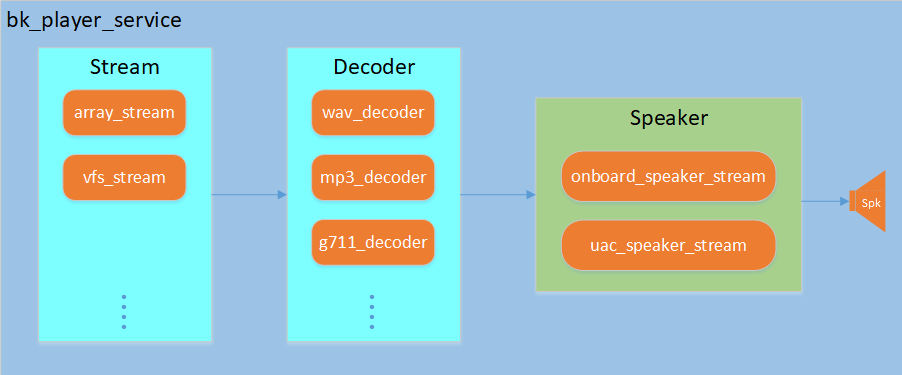

# **播放器服务**


## **1. 简介**

> 播放器服务组件是基于ADK音频开发框架设计实现的音频播放组件。
>
> 支持播放来自各种源（如数组、VFS（虚拟文件系统）和URL）的音频数据。
>
> 支持多种音频格式的解码，如：G711A/U、MP3、WAV等。由于组件是基于音频开发框架设计，客户如需其他数据格式，可自行适配。
>
> 支持板载模拟speaker和uac speaker输出。
>
> 支持创建直接播放的播放器和不直接播放的播放器（解码后的PCM数据可以输出到其他组件进行播放）。


- 有关播放器服务的API参考，请参阅：


  - [播放器服务API参考](../../api-reference/audio/player_service.md "../../api-reference/audio/player_service.md")

- 有关播放器服务的示例工程，请参阅：


  - [播放器服务示例工程](../../examples/projects/multimedia/player_service_example.md "../../examples/projects/multimedia/player_service_example.md")


## **2. 软件框架**

> 软件框架如下图所示：



Figure Player Service Architecture

> 播放器服务内部创建了一个播放pipeline，由输入流、解码器和输出流组成。
>
> - **输入流**：支持数组流(array stream)、VFS流(vfs stream)等多种输入方式，负责读取音频源数据。
> - **解码器**：支持G711A/U、MP3、WAV等多种音频格式的解码，负责将压缩音频数据解码为PCM格式。
> - **输出流**：支持板载speaker和UAC speaker输出，负责将PCM数据播放出来。
>
> 播放器服务还提供了事件监听机制，可以通过注册事件回调函数，获取播放器的状态变化和音乐信息。

备注

1. 播放器服务支持创建不直接播放的播放器，这种情况下，解码后的PCM数据可以通过设置输出端口输出到其他组件进行处理。


## **2. 宏配置**

> 功能宏配置：
>
> |  |  |  |  |
> | --- | --- | --- | --- |
> | Kconfig | CPU | Format | Value |
> | CONFIG_PLAYER_SERVICE | AP | bool | y |
> | CONFIG_PLAYER_SERVICE_SUPPORT_ARRAY_STREAM | AP | bool | y/n |
> | CONFIG_PLAYER_SERVICE_SUPPORT_VFS_STREAM | AP | bool | y/n |
> | CONFIG_PLAYER_SERVICE_SUPPORT_MP3_DECODER | AP | bool | y/n |
> | CONFIG_PLAYER_SERVICE_SUPPORT_G711_DECODER | AP | bool | y/n |
> | CONFIG_PLAYER_SERVICE_SUPPORT_WAV_DECODER | AP | bool | y/n |
>
> 依赖功能宏配置：
>
> |  |  |  |  |
> | --- | --- | --- | --- |
> | Kconfig | CPU | Format | Value |
> | CONFIG_ADK | AP | bool | y |
> | CONFIG_ADK_ARRAY_STREAM | AP | bool | y/n |
> | CONFIG_ADK_VFS_STREAM | AP | bool | y/n |
> | CONFIG_ADK_MP3_DECODER | AP | bool | y/n |
> | CONFIG_ADK_G711_DECODER | AP | bool | y/n |
> | CONFIG_ADK_WAV_DECODER | AP | bool | y/n |
> | CONFIG_ADK_ONBOARD_SPEAKER_STREAM | AP | bool | y/n |

备注

1. 宏配置中value含义： `y` 表示必须打开， `y/n` 表示根据实际需求选择是否开启。
2. 如果需要支持UAC speaker、mp3 decoder等功能，参考音频开发框架中的组件模块说明，打开对应的功能宏以及对应的组件功能宏即可。


## **3. 测试case及参考demo**

> 组件提供了模块测试case和参考使用demo：
> :   `bk_avdk_smp<源代码路径>/ap/components/bk_player_service/cli/`
>
> demo基于播放器组件，支持播放数组中的音频数据和VFS文件系统中的音频文件。

备注

1. `bk_avdk_smp<源代码路径>/ap/include/components/bk_player_service_types.h` 提供了常用方案的默认配置参考，可参阅播放器服务的API文档。


## **4. 典型示例**

> 以典型的应用场景：播放数组中的提示音文件（使用板载speaker）为示例说明播放器组件使用流程。


### 创建播放器并播放提示音文件

详细流程如下：
:   1. 配置播放器参数并创建播放器句柄。
    2. 配置URI信息，设置播放器的URI。
    3. 设置解码类型（仅播放数组音频文件时需要）。
    4. 启动播放器播放提示音文件。

以下为代码示例


```
/* 1. 配置播放器参数并创建播放器句柄 */
bk_player_cfg_t player_cfg = DEFAULT_PLAYER_WITH_PLAYBACK_CONFIG();
player_cfg.spk_cfg.onboard_spk_cfg.sample_rate = 8000;
player_cfg.event_handle = player_event_handler;  // 注册事件回调函数
player_cfg.args = NULL;

bk_player_handle_t player_handle = bk_player_create(&player_cfg);
if (!player_handle)
{
    LOGE("player create fail\n");
    return BK_FAIL;
}

/* 2. 配置URI信息，设置播放器的URI。 */
player_uri_info_t uri_info = {0};
uri_info.uri_type = PLAYER_URI_TYPE_ARRAY;
uri_info.uri = (char *)audio_data_array;  // 音频数据数组指针
uri_info.total_len = sizeof(audio_data_array);  // 音频数据总长度

if (BK_OK != bk_player_set_uri(player_handle, &uri_info))
{
    LOGE("player set uri fail\n");
    return BK_FAIL;
}

/* 3. 设置解码类型（仅播放数组音频文件时需要） */
if (BK_OK != bk_player_set_decode_type(player_handle, AUDIO_DEC_TYPE_PCM))
{
    LOGE("player set decode type fail\n");
    return BK_FAIL;
}

/* 4. 启动播放器播放提示音文件 */
if (BK_OK != bk_player_start(player_handle))
{
    LOGE("player start fail\n");
    return BK_FAIL;
}

```

备注

1. 播放数组中的音频文件时，无法通过文件扩展名来判断解码类型，所以需要通过 `bk_player_set_decode_type` 函数设置解码类型。
2. 播放vfs中的音频文件时，可以通过解析文件扩展名来判断解码类型，因此不需要通过 `bk_player_set_decode_type` 函数设置解码类型。


### 停止播放并注销播放器

详细流程如下：
:   1. 停止播放。
    2. 销毁播放器。

以下为代码示例


```
/* 1. 停止播放 */
if (BK_OK != bk_player_stop(player_handle))
{
    LOGE("player stop fail\n");
    return BK_FAIL;
}

/* 2. 销毁播放器 */
if (BK_OK != bk_player_destroy(player_handle))
{
    LOGE("player destroy fail\n");
    return BK_FAIL;
}

```


## **5. 插播示例**

> 插播应用场景：在播放其他音频流（例如：语音通话、蓝牙听歌等）的同时，穿插播放提示音文件（例如：电量低、导航提示音等）。
>
> 以语音通话过程中插播提示音(vfs中的提示音)为示例说明播放器组件使用流程。


### 创建不直接播放的播放器并播放提示音文件

详细流程如下：
:   1. 配置并启动语音通话。
    2. 配置不带播放功能的播放器参数并创建播放器句柄。
    3. 创建并设置播放器的输出端口。
    4. 绑定播放器的输出端口到语音通话播放模块的输入端口。
    5. 配置URI信息，设置播放器的URI。
    6. 启动播放器播放提示音文件。

以下为代码示例


```
/* 1. 配置并启动语音通话 */
voice_cfg_t voice_cfg = DEFAULT_VOICE_BY_ONBOARD_MIC_SPK_CONFIG();
voice_handle_t voice_handle = bk_voice_init(&voice_cfg);

voice_read_cfg_t voice_read_cfg = VOICE_READ_CFG_DEFAULT();
voice_read_cfg.voice_handle = voice_handle;
voice_read_cfg.max_read_size = 1280;
voice_read_cfg.voice_read_callback = doorbell_udp_voice_send_callback;  //doorbell_udp_voice_send_callback mic data caalback
voice_read_handle_t voice_read_handle = bk_voice_read_init(&voice_read_cfg);

voice_write_cfg_t voice_write_cfg = VOICE_WRITE_CFG_DEFAULT();
voice_write_cfg.voice_handle = voice_handle;
voice_write_handle_t voice_write_handle = bk_voice_write_init(&voice_write_cfg);

bk_voice_start(voice_handle);
bk_voice_read_start(voice_read_handle);
bk_voice_write_start(voice_write_handle);

/* 2. 配置不带播放功能的播放器参数并创建播放器句柄 */
bk_player_cfg_t player_cfg = DEFAULT_PLAYER_NOT_PLAYBACK_CONFIG();
player_cfg.event_handle = player_event_handler;  // 注册事件回调函数
player_cfg.args = NULL;
bk_player_handle_t player_handle = bk_player_create(&player_cfg);
if (!player_handle)
{
    LOGE("player create fail\n");
    return BK_FAIL;
}

/* 3. 创建并设置播放器的输出端口 */
ringbuf_port_cfg_t cfg = RINGBUF_PORT_CFG_DEFAULT();
cfg.ringbuf_size = OUTPUT_RB_SIZE;
audio_port_handle_t output_port_handle = ringbuf_port_init(&cfg);   //根据播放器输出类型创建对应类型port(ringbuffer、framebuffer、callback)
if (!output_port_handle)
{
    LOGE("output port init fail\n");
    return BK_FAIL;
}

if (BK_OK != bk_player_set_output_port(player_handle, output_port_handle))
{
    LOGE("player set output port fail\n");
    return BK_FAIL;
}

/* 4. 绑定播放器的输出端口到语音通话播放模块的输入端口 */
audio_element_handle_t spk_element = bk_voice_get_spk_element(voice_handle);
if (spk_element == NULL)
{
    LOGE("%s, %d, bk_voice_get_spk_element fail\n", __func__, __LINE__);
    return BK_FAIL;
}

audio_port_info_t port_info = DEFAULT_AUDIO_PORT_INFO();
port_info.chl_num = 2;              // 根据提示音格式配置
port_info.sample_rate = 48000;      // 根据提示音格式配置
port_info.dig_gain = 0x2d;          // 根据提示音格式配置
port_info.ana_gain = 0x01;          // 根据提示音格式配置
port_info.bits = 16;                // 根据提示音格式配置
port_info.port_id = 1;
port_info.priority = 1;
port_info.port = output_port_handle;
port_info.notify_cb = player_port_state_notify_handler;
port_info.user_data = NULL;
if (BK_OK != onboard_speaker_stream_set_input_port_info(spk_element, &port_info))
{
    LOGE("%s, %d, audio_element_set_multi_input_port fail\n", __func__, __LINE__);
    return BK_FAIL;
}

/* 5. 配置URI信息，设置播放器的URI */
player_uri_info_t uri_info = {0};
uri_info.uri_type = PLAYER_URI_TYPE_VFS;    // 提示音存储类型
uri_info.uri = "/sd0/doorbell.wav";         // 音频文件路径
if (BK_OK != bk_player_set_uri(player_handle, &uri_info))
{
    LOGE("player set uri fail\n");
    return BK_FAIL;
}

/* 6. 启动播放器播放提示音文件 */
if (BK_OK != bk_player_start(player_handle))
{
    LOGE("player start fail\n");
    return BK_FAIL;
}

```

备注

1. 步骤 4. 绑定播放器到语音通话的输出端口 需要配置播放的音频格式信息，因此如果不确定音频格式信息的话，可以在创建播放器注册的回调函数（解码成功后会上报音频格式信息）中执行这一步骤。
2. 有关语音通话组件的使用请参阅： [语音通话服务开发指南](voice_service.md "voice_service.md")。
3. 有关多音源播放功能的使用请参阅： [音频流开发指南](audio_development_kit/audio_streams.md "audio_development_kit/audio_streams.md")。


### 停止播放并注销播放器

详细流程如下：
:   1. 停止播放器播放。
    2. 播放器的输出端口和语音通话播放模块的输入端口解绑。
    3. 播放器的输出端口和播放器解绑并注销。
    4. 销毁播放器。

以下为代码示例


```
/* 1. 停止播放器播放 */
if (BK_OK != bk_player_stop(player_handle))
{
    LOGE("player stop fail\n");
    return BK_FAIL;
}

/* 2. 播放器的输出端口和语音通话播放模块的输入端口解绑 */
audio_port_info_t port_info = DEFAULT_AUDIO_PORT_INFO();
port_info.chl_num = 2;
port_info.sample_rate = 48000;
port_info.dig_gain = 0x2d;
port_info.ana_gain = 0x01;
port_info.bits = 16;
port_info.port_id = 1;
port_info.priority = 1;
port_info.port = NULL;
port_info.notify_cb = NULL;
port_info.user_data = NULL;
if (BK_OK != onboard_speaker_stream_set_input_port_info(spk_element, &port_info))
{
    LOGE("%s, %d, audio_element_set_multi_input_port fail\n", __func__, __LINE__);
    return BK_FAIL;
}

/* 3. 播放器的输出端口和播放器解绑并注销 */
bk_player_set_output_port(player_handle, NULL);

audio_port_deinit(output_port_handle);

/* 4. 销毁播放器 */
if (BK_OK != bk_player_destroy(player_handle))
{
    LOGE("player destroy fail\n");
    return BK_FAIL;
}

```
