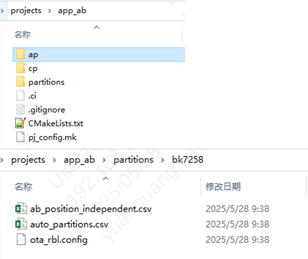

# AB分区位置无关的工程介绍

bk_avdk_smp根目录下的projects/app_ab 为所提供的拥有AB位置无关升级的功能的工程。

重要

- 若使用AB位置无关升级的功能，必须使用app_ab这个工程；

- 在此工程中路径下：projects/app_ab/ap/config/bk7259_ap/config添加想要的的配置即可；

　以app_ab工程为例：bk_avdk_smp/projects/app_ab:

图1 app_ab工程目录
