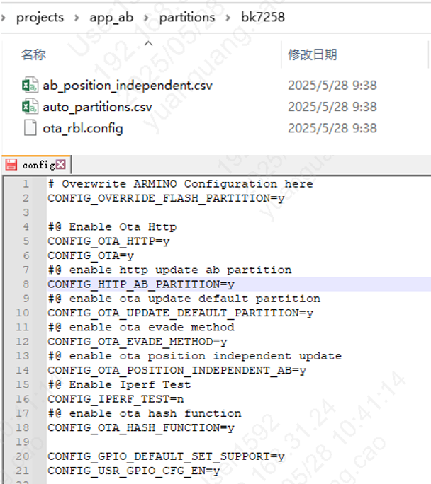
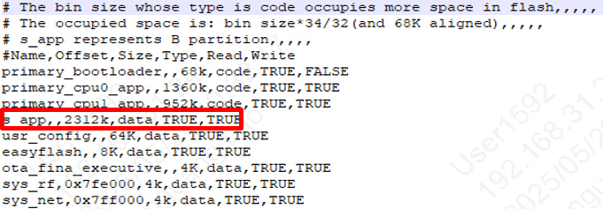

> 本文件未出现在本次官网默认文档目录中，按历史资料保留；当前资料请从 wiki 的 Beken 官方文档分类进入。

# 增加AB分区功能或建立AB工程的介绍

> 一、在新工程中增加AB功能或新建AB工程的修改主要分为以下几点：
>
> - 1、首先，规划AB分区的分区表，增加AB功能相关的宏配置，以及修改ab_position_independent.csv的值，确保开启AB功能；
> - 2、最后，配置pj_config.mk文件（配置bootloader的路径以及自动化编译所需的参数）
> - 3、具体步骤见下述描述。
>
> 二、新增AB分区功能具体步骤如下，以bk_avdk_smp/projects/app_ab 工程为例（可当作example）：
>
> - 1、AB分区的分区表、宏配置如下：
>   :   - 1）需要有ota_rbl.config ，该配置文件是制作AB升级固件时所需的配置；（可直接复制该文件，且该文件位置放置在auto_partitions.csv同级目录文件下）；
>       - 2）然后需要有ab_position_independent.csv，该配置文件用于开启AB功能时所需（可直接复制该.csv文件）;
>       - 3）配置分区表，以auto_partitions.csv为例：
>         :   - a)primary_cp_app、primary_ap_app的size均需为68k的倍数；
>             - b)所需s_app的大小等于两个app分区和的大小；（若app只有一个，则s_app的大小等于该app的大小）；
>             - c)所需ota_fina_executive分区，该分区为存储AB分区升级时的flag；
>       - 4）将该bk_avdk_smp/projects/app_ab/ap/config/bk7259_ap/config文件中的配置宏，拷贝到对应过程中的配置文件中；
>
> 
>
>
> 图1 AB分区config配置
>
>
> 
>
>
> 图2 AB的auto_partitions.csv配置

备注

- 1.app、app1的size均需为68k的倍数；

- 2.s_app的大小等于这两个app分区和的大小;
