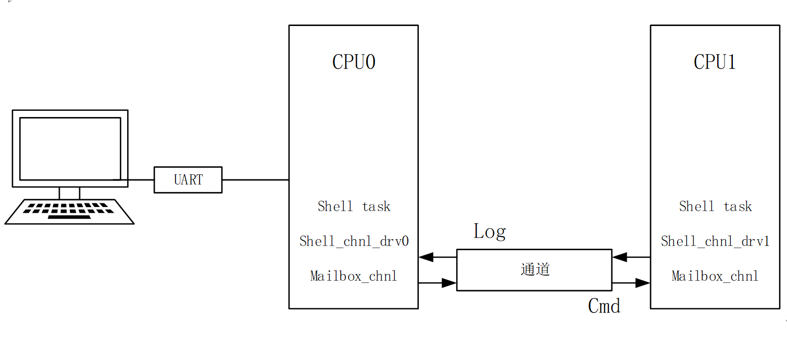

# 系统日志


本文档介绍 Armino 平台 BK7259 CP+AP 双系统的 log 机制。


## 日志输出路径


- CP 侧 log 默认经 DL_UART0 输出（`bk7259` defconfig 中
  `CONFIG_UART_PRINT_PORT=0`，波特率 115200）。可在 CP 工程 menuconfig 中通过
  `CONFIG_UART_PRINT_PORT` 更换串口。

- AP 侧默认经 mailbox 转发到 CP，再由 CP 的 log 串口统一输出（`bk7259_ap.defconfig`
  中 `CONFIG_SYS_PRINT_DEV_MAILBOX=y`）。

- 若需 AP 直连 UART，在 AP menuconfig 关闭 mailbox 打印、开启 UART 打印并配置
  CONFIG_UART_PRINT_PORT（AP defconfig 默认 5，与 CP UART0 不同）。


## Log 前缀

正常运行时，异步 log 会在每行前附加 CPU 标识（由 printf.c 根据 shell_get_cpu_id
与 rtos_get_core_id 生成）：

| 前缀 | 含义 |
| --- | --- |
| `cpu0:` | CP core0 |
| `cpu1:` | CP core1（若 CP 为 SMP） |
| `ap0:` | AP core0（逻辑 CPU2） |
| `ap1:` | AP core1（逻辑 CPU3） |
| 无前缀 | 异常 dump 等同步直出路径 |

CP 日志使用 `cpu` 前缀，AP 日志使用 `ap` 前缀。完整行格式示例：
`ap0:wifi:I(12345):connected`。


## 异步 Log 机制

Armino 默认采用异步 log（`CONFIG_SHELL_ASYNCLOG`）。输出时优先使用静态缓存，
不足时申请动态缓存；两者均耗尽时进入阻塞等待；在不可阻塞场景下会绕过缓存直接
写串口，此时行首带 `INSRT:` 前缀，可能插入到其他 log 之间并打乱时序。

备注

若频繁出现 `INSRT:` 前缀，说明 log 缓存不足。可增大静态缓存数量、提高
`CONFIG_DYM_LOG_MEM_MAX` 上限，或通过 `loginfo` 查看各档缓存耗尽次数。
关闭 `CONFIG_SHELL_ASYNCLOG` 或在串口执行 `log` 命令将 sync 设为 1 可切换
为同步输出；同步模式不经缓存、直接写串口，可能拉长关中断或临界区时间，仅建议
在调试阶段短时使用。


## 串口查看与调整

日常调试串口接在 CP 侧。CP 命令直接输入；AP 侧 log 相关命令需加 `ap_cmd` 前缀
（SMP 工程必选）：


```
log                         # CP 侧查看当前 log 配置
log 1 3 0                   # CP：echo 开、级别 3、异步
ap_cmd log                  # 查看 AP 侧 log 配置
ap_cmd log 1 3 0            # 调整 AP 侧配置

```

`log` 命令参数（与 `cli_main.c` 中 `log_setting_cmd` 一致）：

| 参数 | 说明 |
| --- | --- |
| echo（0 或 1） | 是否在串口回显输入的命令 |
| level（0 至 5） | 运行时打印级别；0 关闭所有级别输出 |
| sync（0 或 1） | 0 异步（默认），1 同步直出 |
| Whitelist（0 或 1） | 模块白名单开关；配合 `modlog tag on/off` 按 tag 过滤 |
| flush（0 或 1，可选） | 异步模式下是否立即刷缓存 |

查询无参数时输出示例：`log: echo 1, level 3, sync 0, white_list 0, flush 1.`

相关命令：loginfo（统计溢出与各档缓存耗尽次数）、modlog（按 tag 开关模块 log）。


## BK7259 AP/CP log 输出机制



多核 log 机制（AP log 经 mailbox 汇聚到 CP 串口）


## API 说明


- Shell 模块支持 log 等级与模块 tag 两级过滤，共同决定某条 log 是否输出到设备。

- 模块 tag 过滤主要作用于显示侧控制，不改变程序内部逻辑。

API 支持 log 等级与模块名（tag）参数。


- Log 等级共 6 级（0 至 5），系统打印级别为 0 时关闭所有 log。

- 打印级别为 N 时，可输出 1 至 N 级 log，(N+1) 至 5 级被过滤。

- 等级定义如下：


```
#define BK_LOG_NONE       0      /*!< No log output */
#define BK_LOG_ERROR      1      /*!< Critical errors, software module can not recover on its own */
#define BK_LOG_WARN       2      /*!< Error conditions from which recovery measures have been taken */
#define BK_LOG_INFO       3      /*!< Information messages which describe normal flow of events */
#define BK_LOG_DEBUG      4      /*!< Extra information which is not necessary for normal use (values, pointers, sizes, etc). */
#define BK_LOG_VERBOSE    5      /*!< Extra information which is not necessary for normal use (values, pointers, sizes, etc). */
#define BK_LOG_DEFAULT    6      /*!< Follow CONFIG_DEBUG_VERSION: DEBUG->4, Release->3 */

```

编译期默认等级：定义 `CONFIG_DEBUG_VERSION` 时为 `BK_LOG_DEBUG`，否则为
`BK_LOG_INFO`。`bk7259_ap` defconfig 中 `CONFIG_LOG_LEVEL=6` 表示使用

``` BK_LOG_DEFAULT``（随 DEBUG/Release 自动选择）。低于编译等级的 log 宏不会生成代码，
以节省 Flash。运行时默认打印等级与编译等级一致，开机后可通过 ``log ``` 命令动态调整。

在 config 中指定编译等级示例（仅输出 WARNING 及以上）:


```
CONFIG_LOG_LEVEL=2

```

封装后的 Log 输出 API：


- Tag：输出 log 的模块名。

- format：printf 风格格式串。


```
BK_LOGE( tag, format, ... );       // ERROR 等级
BK_LOGW( tag, format, ... );       // WARN 等级
BK_LOGI( tag, format, ... );       // INFO 等级
BK_LOGD( tag, format, ... );       // DEBUG 等级
BK_LOGV( tag, format, ... );       // VERBOSE 等级
BK_ASSERT(exp);                    // 表达式为假时关中断、打印位置信息并 dump
BK_ASSERT_EX(exp, format, ... );   // 同上，并附加 format 参数信息
BK_DUMP_OUT(format, ... );         // 关中断下格式化输出
BK_DUMP_RAW_OUT(buf, len);         // 关中断下输出 buf 中 len 字节

```


## Log 缓存大小配置

异步 log 的静态缓存与动态缓存大小均可配置。各侧（CP/AP）在各自的
`components/bk_cli/shell_task.c` 中按 log 输出设备（`LOG_DEV`）区分默认值。


### 静态 Log 缓存

三档长度：40、80、136 字节（`SHELL_LOG_BUF3_LEN`、`SHELL_LOG_BUF2_LEN`、
`SHELL_LOG_BUF1_LEN`）。数量由 `SHELL_LOG_BUF3_NUM`、`SHELL_LOG_BUF2_NUM`、
`SHELL_LOG_BUF1_NUM` 配置。

BK7259 AP（`LOG_DEV == DEV_MAILBOX`，默认 mailbox 转发）典型值：8、40、40。
AP 直连 UART（`LOG_DEV == DEV_UART`）时第三档为 60。

BK7259 CP（`LOG_DEV == DEV_UART`，默认串口直出）典型值：8、40、60；若 CP 使用
mailbox 设备则为 8、40、40。


### 动态 Log 缓存


- 内存上限：在工程 config 中设置 CONFIG_DYM_LOG_MEM_MAX（bk7259_ap defconfig 默认
  0x2000，即 8 KB）。

- 条目上限：shell_task.c 中 SHELL_DYM_LOG_NUM_MAX（AP mailbox 模式默认 400，CP UART
  模式默认 200，以各侧源码为准）。

调试命令与配置项详见 [系统调试](../debug_trace.md "../debug_trace.md")。
