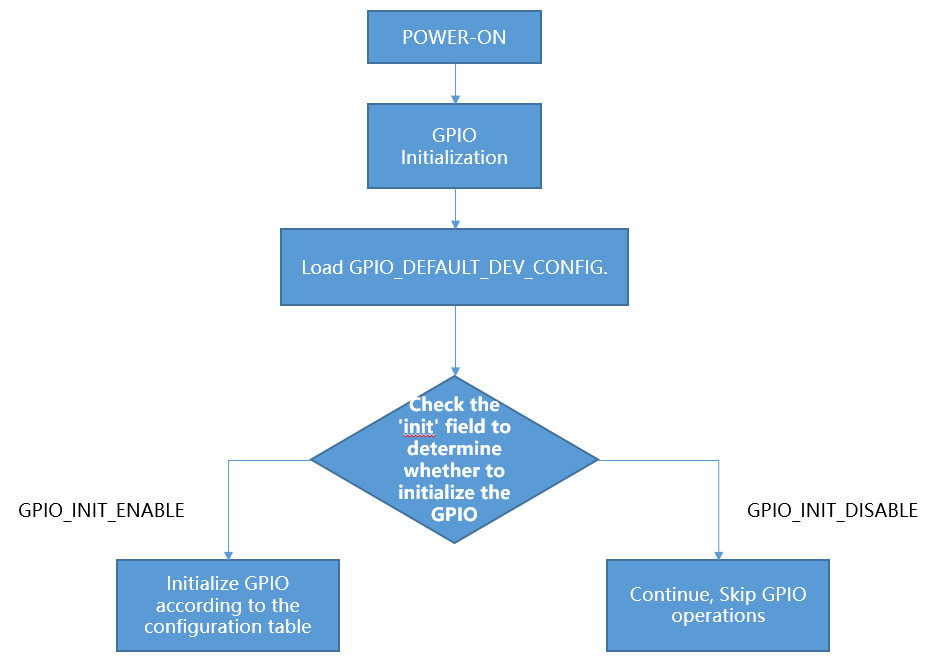
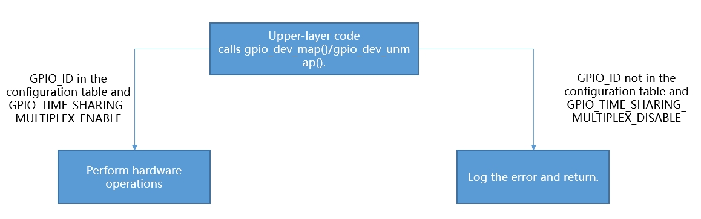

# GPIO 使用指南


## 概述

GPIO（通用输入输出）模块是芯片上用于外部设备信号通信的核心模块。BK7259 芯片最多有 72 个通用输入输出管脚（GPIO_0 ~ GPIO_71，以 SOC_GPIO_NUM 为准），每个管脚都可用作一个通用 IO，或连接一个内部的外设信号。


## GPIO MAP Config

gpio_map.h / 工程的 usr_gpio_cfg.h

> 在每个 CPU 核心驱动初始化过程中，GPIO 会根据映射表（**GPIO_DEFAULT_DEV_CONFIG**）进行配置。
> 当前结构体 **gpio_default_map_t** 中每一行（每个 GPIO）共有 **10** 个字段，含义如下：
>
> > - gpio_id：从 0 开始编号的对应 GPIO 引脚号（GPIO_0 ~ GPIO_71）。
> > - second_func_en：上电是否按 second_func_dev 配置该 pad。**GPIO_SECOND_FUNC_ENABLE** 表示上电应用 second_func_dev 指定的功能；**GPIO_SECOND_FUNC_DISABLE** 表示上电将该 pad 设为高阻态（`FUNC_CODE_HIGH_Z`，此时 second_func_dev 不生效），其方向留待运行期通过 `bk_gpio_enable_output()` / `bk_gpio_enable_input()` 动态设置。
> > - second_func_dev：该 pad 上电要使用的功能（gpio_dev_t）。可填外设功能（如 `GPIO_DEV_I2C1_SCL`/`GPIO_DEV_PWM0`），也可填纯 GPIO 方向：`GPIO_DEV_GPIO_OUTPUT` / `GPIO_DEV_GPIO_INPUT`；不指定功能填 `GPIO_DEV_INVALID`。所选功能必须在 IO Matrix 功能映射（**GPIO_DEV_TO_IOMX_CODE_MAP** / **MAP_FUNC_CODE_FIX_GPIO**，见 gpio_map.h）中合法，该映射由芯片决定，用户不可修改。
> > - time_sharing_func_dev：分时复用（动态 map/unmap）时该 pad 可承担的“额外功能”。上电时 **不会** 被应用，仅用于按功能反查 gpio_id（`gpio_dev_map_by_func` / `gpio_get_id_by_func`）。无分时复用需求时填 `GPIO_DEV_INVALID`。
> > - pull_mode：上下拉模式：``` GPIO_PULL_DISABLE``（浮空）/ ``GPIO_PULL_UP_EN``（上拉）/ ``GPIO_PULL_DOWN_EN``（下拉）。特别地，当 second_func_dev 为 ``GPIO_DEV_GPIO_OUTPUT``（普通输出）时，本字段复用为上电初始输出电平：``GPIO_PULL_UP_EN ``` 输出高电平，`GPIO_PULL_DOWN_EN` 输出低电平，`GPIO_PULL_DISABLE` 则不主动设置初始电平。
> > - int_en：是否使能中断：`GPIO_INT_DISABLE` / `GPIO_INT_ENABLE`（仅当为 ENABLE 时 int_type 才有意义）。
> > - int_type：中断触发方式：`GPIO_INT_TYPE_LOW_LEVEL` / `GPIO_INT_TYPE_HIGH_LEVEL` / `GPIO_INT_TYPE_RISING_EDGE` / `GPIO_INT_TYPE_FALLING_EDGE`（低电平/高电平/上升沿/下降沿触发）。
> > - low_power_io_ctrl：低功耗模式下的 IO 行为。配置 `GPIO_LOW_POWER_KEEP_INPUT_STATUS` 可将 GPIO 设置为唤醒源（需同时开启中断并配置 int_type）；`GPIO_LOW_POWER_KEEP_OUTPUT_STATUS` 保持输出电平；`GPIO_LOW_POWER_DISCARD_IO_STATUS` 进入低功耗时设为高阻防漏电（唤醒后恢复）。
> > - driver_capacity：驱动能力，共四档 `GPIO_DRIVER_CAPACITY_0` ~ ``` GPIO_DRIVER_CAPACITY_3``（0 最弱，3 最强）；I2C/UART 等通常需要较强驱动能力（``_3 ```）。
> > - gpio_skip（旧称 gpio_init）：上电/复位时是否按本表操作该 GPIO。`GPIO_INIT_ENABLE` 按本行配置初始化；`GPIO_INIT_DISABLE` 软重启/上电时不操作该 GPIO（用于软重启中保持状态）。
>
> 备注
>
> 旧版本结构体使用独立的 `io_mode` 字段和 `gpio_time_sharing_multiplex` 标志。当前版本已 **取消 io_mode**：普通 GPIO 的方向直接通过 second_func_dev 的 `GPIO_DEV_GPIO_OUTPUT` / `GPIO_DEV_GPIO_INPUT` 表达；分时复用也改为直接在 `time_sharing_func_dev` 中填写要复用的功能。请以工程 `config/<target>/usr_gpio_cfg.h` 中的实际字段为准。



gpio_initialization



upper_call_map.png


## GPIO 部分使用介绍:

> 1. 新建工程时，客户必须要根据其开发板的配置需求来配置 **GPIO_DEFAULT_DEV_CONFIG** 表。您可以依据 gpio_map.h 中 IO Matrix 功能映射（**GPIO_DEV_TO_IOMX_CODE_MAP** / **MAP_FUNC_CODE_FIX_GPIO**，由 gpio_driver.c 引用）所定义的每个 GPIO 可用功能，自由地配置 **GPIO_DEFAULT_DEV_CONFIG** 表。
>    GPIO外设初始化时会在gpio_driver_base.c的gpio_default_map_init（）函数里按照 **GPIO_DEFAULT_DEV_CONFIG** 表初始化GPIO（需要打开宏CONFIG_USR_GPIO_CFG_EN，平台只会操作一次，
>    后面以用户配置为准,如果没有开启该宏，则平台不会操作GPIO，GPIO默认值为 **高阻态**）。
> 2. 以自定义方式覆盖默认的 **GPIO_DEFAULT_DEV_CONFIG** 时，可按以下步骤操作：
>
> > - 打开宏定义：在项目配置文件中开启 CONFIG_USR_GPIO_CFG_EN 宏，以启用自定义 GPIO 配置功能。
> > - 创建 usr_gpio_cfg.h 文件：在项目的合适位置创建 usr_gpio_cfg.h 头文件，并在该文件中定义你自定义的 GPIO_DEFAULT_DEV_CONFIG。此配置应包含你所需的所有 GPIO 的初始化设置和映射关系。如 `projects/app/ap/config/bk7259_ap` 所示。
> >
> > > 需要注意的是，新映射的功能必须已在 IO Matrix 功能映射（**GPIO_DEV_TO_IOMX_CODE_MAP** / **MAP_FUNC_CODE_FIX_GPIO**）中定义。在初始化过程中，芯片会根据 **GPIO_DEFAULT_DEV_CONFIG** 表来配置 GPIO 的状态。（注意：确保在代码中包含 usr_gpio_cfg.h 文件，这样在编译时就会使用你自定义的 GPIO 配置。）
>
> 3. 低功耗状态：在低功耗状态下，GPIO 可配置为输入模式（唤醒源）和输出模式。如果在低功耗期间不使用相应的 GPIO（GPIO_LOW_POWER_DISCARD_IO_STATUS），低功耗模式程序会将GPIO 设置为高阻状态，以防止在低功耗模式下出现漏电现象。
> 4. 当你需要在低功耗模式下保持 GPIO 的输出状态时，有两种办法设置：
>
> > - 按照说明配置 **GPIO_DEFAULT_DEV_CONFIG** 表。
> > - 使用 bk_gpio_register_lowpower_keep_status() 函数注册。目前默认数量为4，可使用CONFIG_GPIO_DYNAMIC_KEEP_STATUS_MAX_CNT修改数量）
> > - 使用 bk_gpio_unregister_lowpower_keep_status（）函数可以取消之前注册需要保持的GPIO。
>
> 5. 当进入低功耗模式时，可以将多个外部 GPIO 设置为唤醒源。如果任何一个 GPIO 产生中断信号，芯片就能从低功耗模式中唤醒。目前有三种办法设置为唤醒源：
>
> > - 按照说明配置 **GPIO_DEFAULT_DEV_CONFIG** 表。
> > - **GPIO_STATIC_WAKEUP_SOURCE_MAP** 中设置多个唤醒源。
> > - 使用 bk_gpio_register_wakeup_source（）函数注册。（目前默认数量为4，可使用CONFIG_GPIO_DYNAMIC_WAKEUP_SOURCE_MAX_CNT修改数量）
> > - 使用 bk_gpio_unregister_wakeup_source（）函数可以取消注册的唤醒源。
>
> 6. 当进入低功耗模式（仅适用于低压情况）时，GPIO 的状态将被备份。退出低功耗模式后，GPIO 会自动恢复到进入该模式之前的状态。
>    （**note**：从深度睡眠模式退出后，相当于进行了一次软重启，GPIO状态不会自动恢复，会重新走初始化流程，如果需要从深度睡眠模式退出保持GPIO的状态，见第8点）
> 7. GPIO在软件重启过程中保持状态
>
> > - 将对应 GPIO_ID 的 gpio_skip（旧称 gpio_init）字段置为 GPIO_INIT_DISABLE
>
> 8. 设置输入中断检测时，需要确保开启中断前，电平状态稳定，处理逻辑如下：先将电平钳位在高电平或者低电平（根据中断触发方式决定），即如果是上升沿触发中断，则一开始就需要
>    将GPIO设置到拉低状态，防止抖动或高阻态随机值引起误触发。
> 9. CP/AP必须配置自己的GPIO，且同一GPIO不能在CP和AP上重复配置。
> 10. 未明确分配的GPIO无法map/unmap，默认状态为高阻态，只能当做GPIO使用。
> 11. SDK内部集成了key组件，用户可以通过该组件快速实现按键检测功能。key组件路径为 `ap/components/key`，使用方式可以参考 `ap/components/bk_cli/cli_key.c`。

备注


- usr_gpio_cfg.h 必须被配置。

- 当GPIO设置为电平触发中断时，若检测引脚的有效电平持续存在，将导致中断反复触发。

- GPIO 的驱动能力如下表所示。REG 表示 GPIO 寄存器的设置值，驱动能力共有四个等级。
  :   |  | REG=2 | REG=102 | REG=202 | REG=302 |
      | --- | --- | --- | --- | --- |
      | P14 | 10.49 | 19.95 | 33.72 | 40.8 |
      | P15 | 10.48 | 19.9 | 33.28 | 40.03 |
      | P16 | 10.41 | 19.65 | 32.76 | 39.35 |
      | P17 | 10.36 | 19.45 | 32.26 | 38.6 |

      > - 高电平拉电流(mA)

      |  | REG=0 | REG=100 | REG=200 | REG=300 |
      | --- | --- | --- | --- | --- |
      | P14 | 8.54 | 16.09 | 26.05 | 32 |
      | P15 | 8.56 | 16.19 | 26.47 | 32.6 |
      | P16 | 8.56 | 16.35 | 26.87 | 33.24 |
      | P17 | 8.62 | 16.5 | 27.24 | 33.85 |

      > - 低电平灌电流(mA)


## 配置 usr_gpio_cfg.h

工程的 GPIO 默认配置表写在 `projects/<工程>/config/<target>/usr_gpio_cfg.h` 的宏 **GPIO_DEFAULT_DEV_CONFIG** 中（例如 servo_example 的 `projects/multimedia/servo_example/ap/config/bk7259_ap/usr_gpio_cfg.h`）。
该头文件的开头注释里完整说明了每个字段含义、配置规则，以及本工程已固定配置的引脚-功能对应关系，建议先阅读该文件再修改。

使用步骤：

> - `CONFIG_USR_GPIO_CFG_EN` 在 SDK 中默认使能（见 SoC defconfig），本表即生效；若在工程 defconfig 中将其关闭，平台不操作 GPIO，所有 GPIO 保持上电默认（高阻）态。
> - 按下面字段顺序逐行填写：`{gpio_id, second_func_en, second_func_dev, time_sharing_func_dev, pull_mode, int_en, int_type, low_power_io_ctrl, driver_capacity, gpio_skip}`。
> - second_func_dev 选用的功能必须在 gpio_map.h 的 IO Matrix 映射中合法（见下节“固定功能 GPIO 映射”）。

Example:

GPIO_0 配置为 `GPIO_DEV_I2C1_SCL`、GPIO_1 配置为 `GPIO_DEV_I2C1_SDA`（I2C，需要更强驱动能力）:


```
{GPIO_0, GPIO_SECOND_FUNC_ENABLE, GPIO_DEV_I2C1_SCL, GPIO_DEV_INVALID, GPIO_PULL_UP_EN,  GPIO_INT_DISABLE, GPIO_INT_TYPE_LOW_LEVEL, GPIO_LOW_POWER_DISCARD_IO_STATUS, GPIO_DRIVER_CAPACITY_3, GPIO_INIT_ENABLE},
{GPIO_1, GPIO_SECOND_FUNC_ENABLE, GPIO_DEV_I2C1_SDA, GPIO_DEV_INVALID, GPIO_PULL_UP_EN,  GPIO_INT_DISABLE, GPIO_INT_TYPE_LOW_LEVEL, GPIO_LOW_POWER_DISCARD_IO_STATUS, GPIO_DRIVER_CAPACITY_3, GPIO_INIT_ENABLE},

```

GPIO_5 作为普通输出脚（上电输出高电平；pull_mode=``GPIO_PULL_UP_EN`` 表示初始电平为高）:


```
{GPIO_5, GPIO_SECOND_FUNC_ENABLE, GPIO_DEV_GPIO_OUTPUT, GPIO_DEV_INVALID, GPIO_PULL_UP_EN, GPIO_INT_DISABLE, GPIO_INT_TYPE_LOW_LEVEL, GPIO_LOW_POWER_DISCARD_IO_STATUS, GPIO_DRIVER_CAPACITY_0, GPIO_INIT_ENABLE},

```

GPIO_5 保持高阻态（初始化时不操作该 GPIO）:


```
{GPIO_5, GPIO_SECOND_FUNC_DISABLE, GPIO_DEV_INVALID, GPIO_DEV_INVALID, GPIO_PULL_DISABLE, GPIO_INT_DISABLE, GPIO_INT_TYPE_LOW_LEVEL, GPIO_LOW_POWER_DISCARD_IO_STATUS, GPIO_DRIVER_CAPACITY_0, GPIO_INIT_DISABLE},

```

GPIO_5 输入模式 + 下降沿触发中断（先上拉钳位，避免误触发）:


```
{GPIO_5, GPIO_SECOND_FUNC_ENABLE, GPIO_DEV_GPIO_INPUT, GPIO_DEV_INVALID, GPIO_PULL_UP_EN, GPIO_INT_ENABLE, GPIO_INT_TYPE_FALLING_EDGE, GPIO_LOW_POWER_DISCARD_IO_STATUS, GPIO_DRIVER_CAPACITY_0, GPIO_INIT_ENABLE},

```

GPIO_5 作为低功耗唤醒源（下降沿唤醒，low_power_io_ctrl 设为 KEEP_INPUT）:


```
{GPIO_5, GPIO_SECOND_FUNC_ENABLE, GPIO_DEV_GPIO_INPUT, GPIO_DEV_INVALID, GPIO_PULL_UP_EN, GPIO_INT_ENABLE, GPIO_INT_TYPE_FALLING_EDGE, GPIO_LOW_POWER_KEEP_INPUT_STATUS, GPIO_DRIVER_CAPACITY_0, GPIO_INIT_ENABLE},

```


## 固定功能 GPIO 映射（fixed GPIO）

芯片用两张表描述“哪个功能可以放到哪个 pad”，均位于 gpio_map.h，用户不可修改：

> - **GPIO_DEV_TO_IOMX_CODE_MAP**（灵活映射）：UART/SPI/I2C/PWM/I2S 等可走任意 pad，second_func_dev 填对应功能即可，不限定具体 GPIO 编号。
> - **MAP_FUNC_CODE_FIX_GPIO**（固定映射，即 fixed GPIO）：SDIO/JPEG-DVP/RGB-LCD/QSPI/ENET/UART5/调试信号等，只能落在表中写明的那一个（或几个）pad 上，每行是 `{功能, FUNC_CODE_xxx, GPIO_x}` 三元组。

常见 FUNC_CODE 分组：`126` 系统/射频，`127` DEBUG，`129` SDIO/JPEG，`130` QSPI/ENET/UART5，`131` RGB-LCD，`132` ENET(备用脚)。

下表是 **MAP_FUNC_CODE_FIX_GPIO** 的二维视图：纵轴为 GPIO_ID，横轴为 FUNC_CODE 分组，单元格为该 (GPIO, FUNC_CODE) 组合允许复用的功能（已省略 `GPIO_DEV_` 前缀，`DEBUG` 简写为 `DBG`，空白表示该组合无定义）。某 GPIO 想用某固定功能，必须能在对应单元格里找到它，再把 second_func_dev 填成 `GPIO_DEV_<功能>`。本表随芯片固定，若与 gpio_map.h 不一致，以 gpio_map.h 为准:


```
GPIO    126:SYS/RF  127:DEBUG 129:SDIO/JPEG    130:QSPI/ENET/UART5 131:RGB-LCD 132:ENET-alt

--------------------------------------------------------------------------------------------
GPIO_2  OTP_FRE_EN  DBG0      SDIO_HOST_CLK    QSPI1_CLK
GPIO_3  OTP_FRE_SEL DBG1      SDIO_HOST_CMD    QSPI1_CSN
GPIO_4  OTP_FRE_OUT DBG2      SDIO_HOST_DATA0  QSPI1_IO0
GPIO_5              DBG3      SDIO_HOST_DATA1  QSPI1_IO1
GPIO_6  CLK13M      DBG4      SDIO_HOST_DATA4  QSPI1_IO2
GPIO_7  WIFI_ACTIVE DBG5      SDIO_HOST_DATA5  QSPI1_IO3
GPIO_8              DBG6      SDIO_HOST_DATA6
GPIO_9              DBG7      SDIO_HOST_DATA7
GPIO_10                       SDIO_HOST_DATA2  CLK_AUXS
GPIO_11                       SDIO_HOST_DATA3
GPIO_12                       SDIO_HOST_STB
GPIO_13                                                            ENET_GTCLK
GPIO_14             DBG8      SDIO1_HOST_CLK                       LCD_DE      ENET_TXD3
GPIO_15             DBG9      SDIO1_HOST_CMD                       LCD_VSYNC   ENET_TXD2
GPIO_16             DBG10     SDIO1_HOST_DATA0                     LCD_HSYNC   ENET_TXD1
GPIO_17             DBG11     SDIO1_HOST_DATA1                     LCD_DISP    ENET_TXD0
GPIO_18             DBG12     SDIO1_HOST_DATA2                     LCD_CLK     CLK_AUXS_ENET
GPIO_19             DBG13     SDIO1_HOST_DATA3                     LCD_B7      ENET_MDC
GPIO_20                       SDIO1_HOST_DATA4                     LCD_B6      ENET_MDIO
GPIO_21                       SDIO1_HOST_DATA5 ENET_REF_CLK        LCD_B5      ENET_GRCLK
GPIO_22 CLK26M                SDIO1_HOST_DATA6 QSPI0_CLK           LCD_B4      ENET_RXDV
GPIO_23                       SDIO1_HOST_DATA7 QSPI0_CSN           LCD_B3      ENET_RXD0
GPIO_24 LPO_CLK     DBG14     SDIO1_HOST_STB   QSPI0_IO0           LCD_G7      ENET_RXD1
GPIO_25             DBG15                      QSPI0_IO1           LCD_G6      ENET_RXD2
GPIO_26 WIFI_TX_EN  DBG16                      QSPI0_IO2           LCD_G5      ENET_RXD3
GPIO_27 FEM_LNA_EN  DBG17     CLK_AUXS_CIS     QSPI0_IO3           JPEG_MCLK
GPIO_28 WIFI_RX_EN  DBG18     CLK_AUXS                                         ENET_TXEN
GPIO_29             DBG19     JPEG_PCLK
GPIO_30             DBG20     JPEG_HSYNC
GPIO_31             DBG21     JPEG_VSYNC
GPIO_32             DBG22     JPEG_PXDATA0
GPIO_33             DBG23     JPEG_PXDATA1
GPIO_34             DBG24     JPEG_PXDATA2
GPIO_35             DBG25     JPEG_PXDATA3
GPIO_36             DBG26     JPEG_PXDATA4
GPIO_37             DBG27     JPEG_PXDATA5
GPIO_38             DBG28     JPEG_PXDATA6
GPIO_39             DBG29     JPEG_PXDATA7
GPIO_40                       JPEG_PXDATA8     ENET_GTCLK          LCD_G4
GPIO_41                       JPEG_PXDATA9     ENET_TXD3           LCD_G3
GPIO_42             DBG30                      ENET_TXD2           LCD_G2
GPIO_43             DBG31                      ENET_TXD1           LCD_R7
GPIO_44                                        ENET_TXD0           LCD_R6
GPIO_45                                        ENET_TXEN           LCD_R5
GPIO_46                                        CLK_AUXS_ENET       LCD_R4
GPIO_47                                        ENET_MDC            LCD_R3
GPIO_48                                        ENET_MDIO           LCD_B2
GPIO_49                       ENET_REF_CLK     ENET_GRCLK          LCD_B1
GPIO_50                                        ENET_RXDV           LCD_B0
GPIO_51                                        ENET_RXD0           LCD_G1
GPIO_52                                        ENET_RXD1           LCD_G0
GPIO_53                                        ENET_RXD2           LCD_R2
GPIO_54                                        ENET_RXD3           LCD_R1
GPIO_55                                        ENET_PHY_INT        LCD_R0
GPIO_59                       CLK_AUXS_CIS
GPIO_60                                        ENET_PHY_INT
GPIO_61                       SDIO_HOST_STB
GPIO_62                       SDIO_HOST_DATA7
GPIO_63                       SDIO_HOST_DATA6
GPIO_64                       SDIO_HOST_DATA5  UART5_RXD
GPIO_65                       SDIO_HOST_DATA4  UART5_TXD
GPIO_66                       SDIO_HOST_DATA3
GPIO_67                       SDIO_HOST_DATA2
GPIO_68                       SDIO_HOST_DATA1
GPIO_69                       SDIO_HOST_DATA0
GPIO_70                       SDIO_HOST_CMD
GPIO_71                       SDIO_HOST_CLK

```

固定映射 demo —— 把 JPEG/DVP 像素时钟配到它唯一允许的 GPIO_29：上表 GPIO_29 行的 129 列是 JPEG_PCLK（即 `{GPIO_DEV_JPEG_PCLK, FUNC_CODE_129, GPIO_29}`），再在 GPIO_DEFAULT_DEV_CONFIG 中按该 pin 配置:


```
{GPIO_29, GPIO_SECOND_FUNC_ENABLE, GPIO_DEV_JPEG_PCLK, GPIO_DEV_INVALID, GPIO_PULL_DISABLE, GPIO_INT_DISABLE, GPIO_INT_TYPE_LOW_LEVEL, GPIO_LOW_POWER_DISCARD_IO_STATUS, GPIO_DRIVER_CAPACITY_0, GPIO_INIT_ENABLE},

```


## GPIO 调试命令（gpio_dump）

SDK 提供了 `gpio_dump` CLI 命令，可直接通过串口控制台查看 GPIO 引脚的运行时配置。该命令读取的是 pad 的实时寄存器，因此反映的是硬件的实际状态，而非静态配置表。

用法：

> - `gpio_dump` : 以表格形式打印所有引脚的概要信息（每个引脚一行）。
> - `gpio_dump <id>` : 打印单个引脚的详细信息，`<id>` 为 GPIO 编号（例如 `gpio_dump 12`）。

各列/字段含义如下：

> - **Function** : 解析后的引脚功能名（例如 `UART0_TXD`、`LCD_CLK`、`GPIO_IN`）。灵活 IO-matrix 功能与固定映射外设均可解析。
> - **Direction** : 普通 GPIO 显示 `HIGH-Z` / `INPUT` / `OUTPUT` / `IN+OUT`；当引脚复用为外设时显示 `FUNC`。
> - **Pull** : `FLOAT` / `PULL_UP` / `PULL_DOWN`（浮空/上拉/下拉）。
> - **Drive** : 驱动能力等级（0~3）。
> - **Level** : 当前引脚电平（输入脚显示输入电平，输出脚显示输出电平，其他显示 `-`）。
> - **Interrupt** : `DISABLED` / `LOW_LEVEL` / `HIGH_LEVEL` / `RISING_EDGE` / `FALLING_EDGE`（关闭/低电平/高电平/上升沿/下降沿）。

示例 —— 打印所有引脚:


```
================== GPIO STATUS DUMP ( SOC_GPIO_NUM=72 ) ==================
 GPIO | Function         | Direction | Pull        | Drive | Level | Interrupt

------+------------------+-----------+-------------+-------+-------+-------------
 0    | GPIO_IN          | INPUT     | PULL_UP     |   0   |   1   | DISABLED
 1    | UART0_TXD        | FUNC      | FLOAT       |   2   |   -   | DISABLED
 12   | GPIO_OUT         | OUTPUT    | FLOAT       |   0   |   0   | DISABLED
 ...

```

示例 —— 打印单个引脚:


```
================= GPIO[1] CONFIG =================
  Function : UART0_TXD        (fun_sel=0x60)
  Direction: FUNC
  Pull     : FLOAT
  Drive    : 2  (level 0~3)
  Level    : -
  Interrupt: DISABLED
  Raw CFG  : 0x60000204
==================================================

```


## GPIO 调试打点（GPIO_UP / GPIO_DOWN）

为方便在 FPGA/芯片上做时序打点调试，`soc/bk7259/soc_debug.h` 提供了一组直接操作 AON GPIO 寄存器的调试宏（**非公开 API，仅用于调试**）：

> - `GPIO_UP(id)` : 将指定 GPIO 立即拉高。
> - `GPIO_DOWN(id)` : 将指定 GPIO 立即拉低。
> - `GPIO_UP_DOWN(id)` : 在指定 GPIO 上连续输出若干个高低脉冲（自带忙等待延时）。

这些宏直接写 AON GPIO 寄存器（`SOC_AON_GPIO_REG_BASE`），绕过 GPIO 驱动，因此所选引脚必须空闲、未被其它外设或 GPIO 配置占用。

总开关 `CONFIG_GPIO_DEBUG_ENABLE`
:   为避免调试打点代码误留到正式固件中影响引脚，这组宏由总开关 `CONFIG_GPIO_DEBUG_ENABLE` 统一控制，定义在 AP/CP 各自的 `soc/bk7259/soc_debug.h` 中：


    - **默认值为 0（关闭）**：`GPIO_UP` / `GPIO_DOWN` / `GPIO_UP_DOWN` 全部编译为空操作（no-op），不产生任何寄存器访问，所有调试打点自动失效。

    - 需要使用时，手动把对应核（AP 或 CP）``soc_debug.h`` 中的 `CONFIG_GPIO_DEBUG_ENABLE` 改为 1 后重新编译即可生效。

    备注


    - AP 核与 CP 核各有一份 `soc_debug.h`，需在使用打点的核上分别开启。

    - 该开关为严格单一开关：其它依赖 `GPIO_UP` / `GPIO_DOWN` 的功能（如 GPIO 日志 `CONFIG_GPIO_LOG_ENABLE`）在开关关闭时同样不翻转引脚，使用时需一并开启本开关。

示例 —— 在 GPIO_12 上对某段代码做耗时打点:


```
#include "soc_debug.h"

GPIO_UP(12);      /* 进入待测区间，拉高 */
do_something();
GPIO_DOWN(12);    /* 退出区间，拉低 */

```


## GPIO map / 输入输出使能错误处理

当 GPIO 功能映射或输入/输出使能失败时，接口会返回非 0 错误码并打印相应日志。常见错误及处理方式如下：

1. **map 外设功能失败**：`gpio_dev_map()` / `gpio_dev_map_by_func()` 返回 `BK_ERR_GPIO_SET_INVALID_FUNC_MODE`，日志打印
   `GPIO device <dev> is not supported (not in GPIO_DEV_TO_IOMX_CODE_MAP or MAP_FUNC_CODE_FIX_GPIO)`。


   - 原因：所选 second_func_dev 在灵活映射中不存在；或它属于固定映射，但 GPIO 编号与 MAP_FUNC_CODE_FIX_GPIO 中规定的 pad 不一致。

   - 处理：对照 gpio_map.h，灵活功能确认拼写正确；固定功能必须使用表中规定的 GPIO 编号（参见上节“固定功能 GPIO 映射”）。
2. **按功能反查失败**：`gpio_dev_map_by_func()` / `gpio_dev_unmap_by_func()` 返回 `BK_ERR_GPIO_CHAN_ID`，日志
   `func <dev> not in GPIO_DEFAULT_DEV_CONFIG`。


   - 原因：要复用的功能没有写进本工程的 usr_gpio_cfg.h（second_func_dev 或 time_sharing_func_dev）。

   - 处理：在 GPIO_DEFAULT_DEV_CONFIG 对应行的 `time_sharing_func_dev` 填上该功能后重新编译。
3. **输入/输出使能失败**（仅在 `CONFIG_USR_GPIO_CFG_EN` 打开时校验）：`bk_gpio_enable_output()` / `bk_gpio_enable_input()`（以及走它们的 `bk_gpio_set_config()`）返回 `BK_ERR_GPIO_CHAN_ID`，日志
   `gpio <id> not configured as OUTPUT/INPUT in usr_gpio_cfg.h`。


   - 原因：该 pad 在 usr_gpio_cfg.h 里没有被配置成 `GPIO_DEV_GPIO_OUTPUT` / `GPIO_DEV_GPIO_INPUT`（second_func_dev 或 time_sharing_func_dev 都不是对应方向），平台不允许越过配置表直接改方向。

   - 处理：把对应行的 second_func_dev（或 time_sharing_func_dev）改成所需的 `GPIO_DEV_GPIO_OUTPUT` / `GPIO_DEV_GPIO_INPUT`。
4. **非法 GPIO 编号 / 参数**：返回 `BK_ERR_GPIO_INVALID_ID` / `BK_ERR_GPIO_INVALID_MODE` / `BK_ERR_GPIO_INVALID_INT_TYPE`。


   - 处理：gpio_id 不得超过 `SOC_GPIO_NUM`；second_func_dev、中断类型等须使用合法枚举值。

排查建议：调用相关 API 时用 `BK_LOG_ON_ERR()` 包裹以打印返回值；再用 `gpio_dump <id>` 查看该 pad 的实时寄存器状态，核对 Function/Direction 是否与预期一致。注意 CP/AP 必须各自配置自己的 GPIO，同一 GPIO 不能在两核重复配置。


## Q&A

1. 低压模式设置了RTC和GPIO中断，RTC触发后GPIO则失效了。

   该问题原因为在进入低压模式之前，MCU会备份GPIO的状态。为了防止未使能唤醒GPIO引脚的中断，导致MCU无法被唤醒，在低压模式下，唤醒GPIO的引脚中断会被使能。
   退出中断后，该引脚的状态会恢复到进入低压之前的状态。如果在进入低压模式之前未使能唤醒引脚的中断，那么在退出低压后，该引脚的中断仍然未被使能，因此在正
   常工作模式下唤醒GPIO的中断无法被触发。
2. 进入深度休眠后，敲一下串口，设备会唤醒。
   因为一些场景需求，默认支持在low voltage、 deepsleep时使用uart来唤醒设备。如果不需要该功能，可以在gpio_map.h中将GPIO_STATIC_WAKEUP_SOURCE_MAP中GPIO_10注释掉。
3. 多核操作同一个GPIO之间的协同问题，某客户在多核系统中未采用CPU独立配置GPIO方案，导致以下典型问题，表象如下：

> - 使用dvp摄像头打开后，按键中断偶现丢失。
> - 单独打开lcd或uvc时，按键gpio中断50%概率左右不会触发
>
> 多个CPU共享硬件资源。所有的GPIO引脚共享GPIO中断线。如果每个CPU没有配置自己需要控制的GPIO，在GPIO发生中断时，多个CPU核心都会接到中断通知，执行中断处理函数。
> 开dvp和lcd等操作都会开启CPU1，CPU1的主频比CPU0快，可能会清掉中断标志位，造成CPU0的GPIO中断丢失，导致程序为按照预期执行。为避免这种情况，每个CPU必须配置各自的GPIO_MAP表。


## Application Example

DEMO1:
:   GPIO_0 as wake-up source for DeepSleep or LowPower, pseudo code description and interpretation.


GPIO as wake-up source for DeepSleep or LowPower


## GPIO API Reference

> [GPIO的驱动API](../../api-reference/peripheral/bk_gpio.md "../../api-reference/peripheral/bk_gpio.md")
