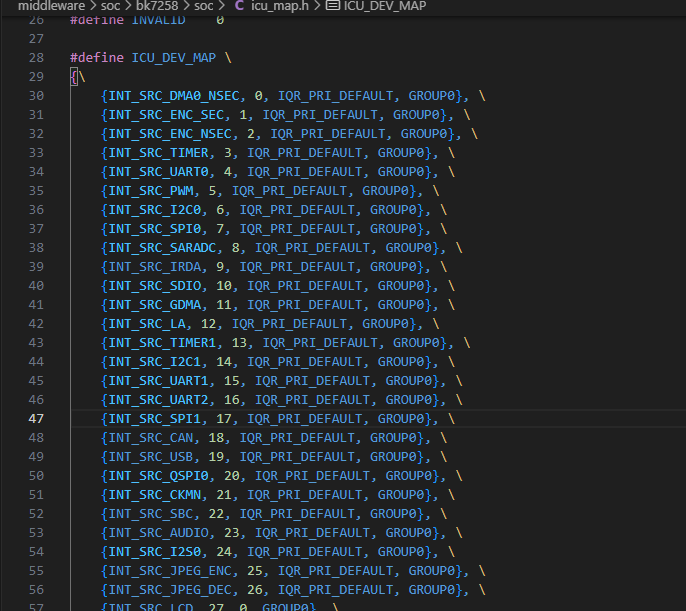

# ICU (Interrupt Control Unit)


为了兼容不同的CPU架构，设计了中断管理的核心模块为ICU，源码位于middleware/driver/icu/interrupt_base.c ，
在ICU中设置了一张map表，用来记录当前所有的外部中断的信息，如中断号、默认优先级等等。



ICU map

同时提供了如下API供应用层使用：


```
bk_err_t bk_int_isr_register(icu_int_src_t src, int_group_isr_t isr_callback, void*arg) 使能某个中断，配置为ICU_DEV_MAP中的优先级，并注册回调函数
bk_err_t bk_int_set_priority(icu_int_src_t int_src, uint32_t int_priority) 设置某个中断的优先级
bk_err_t bk_int_isr_unregister(icu_int_src_t src) 关闭某个中断

```

设置中断优先级方法：

> - 编译固件前重新配置icu map表中相关中断的优先级；
> - 在运行过程中调用函数bk_int_set_priority()进行设置。
