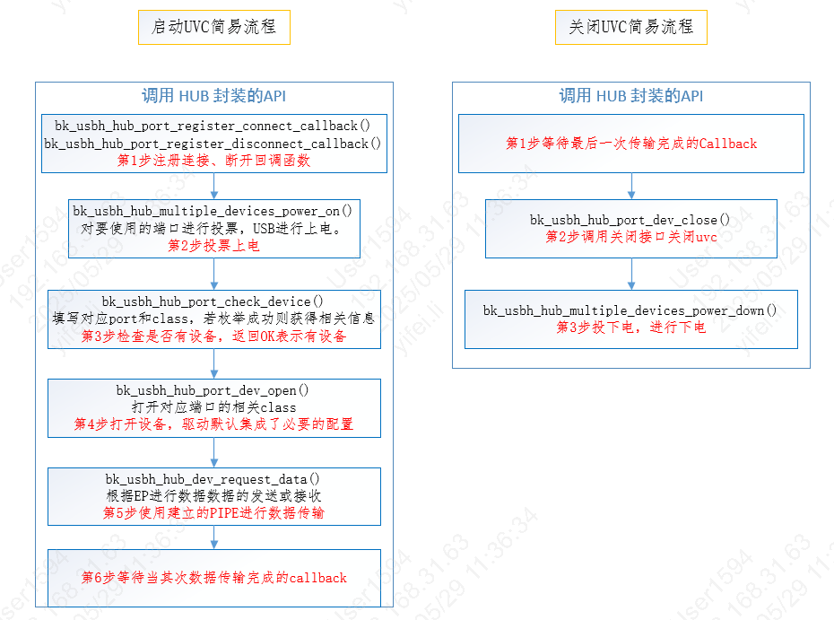
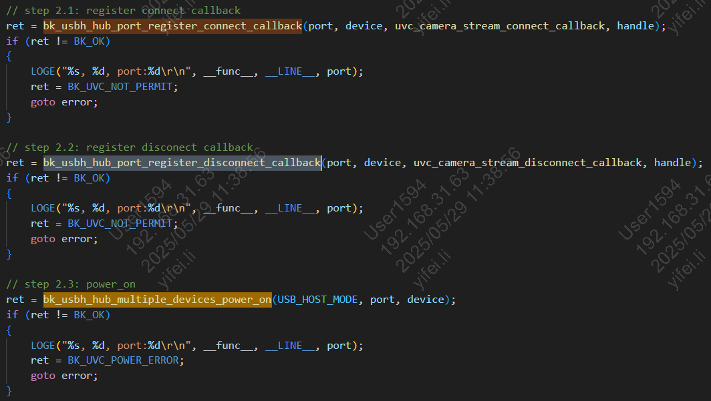
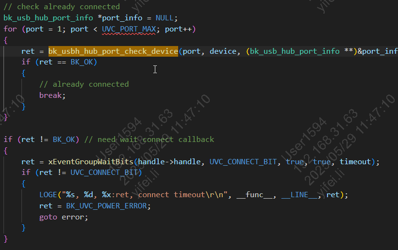
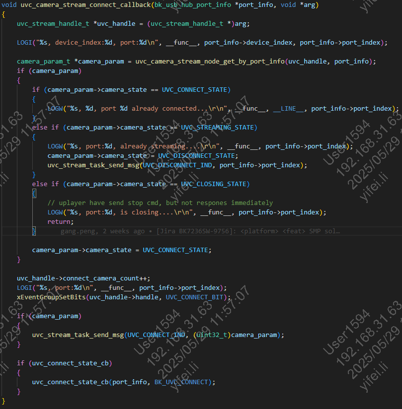
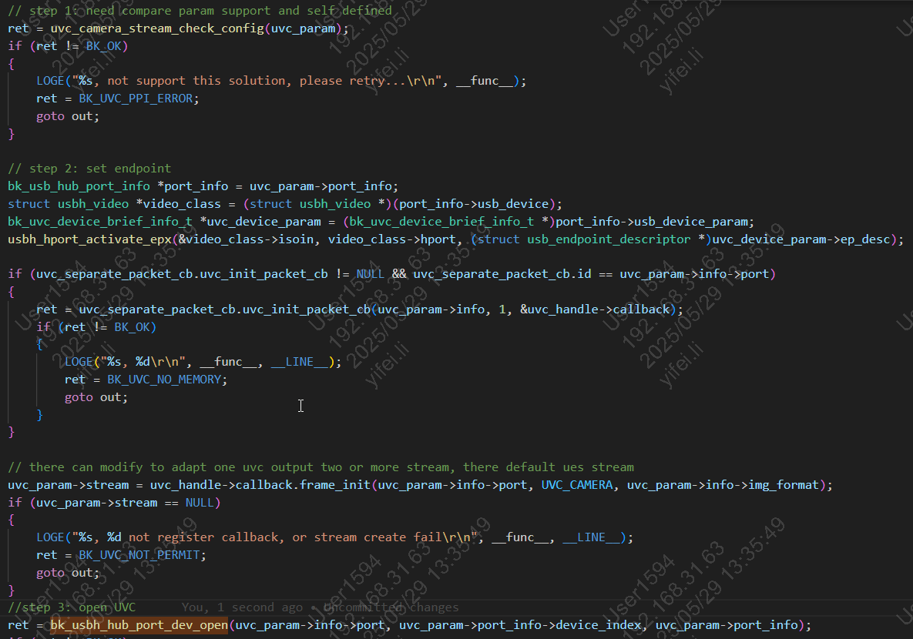
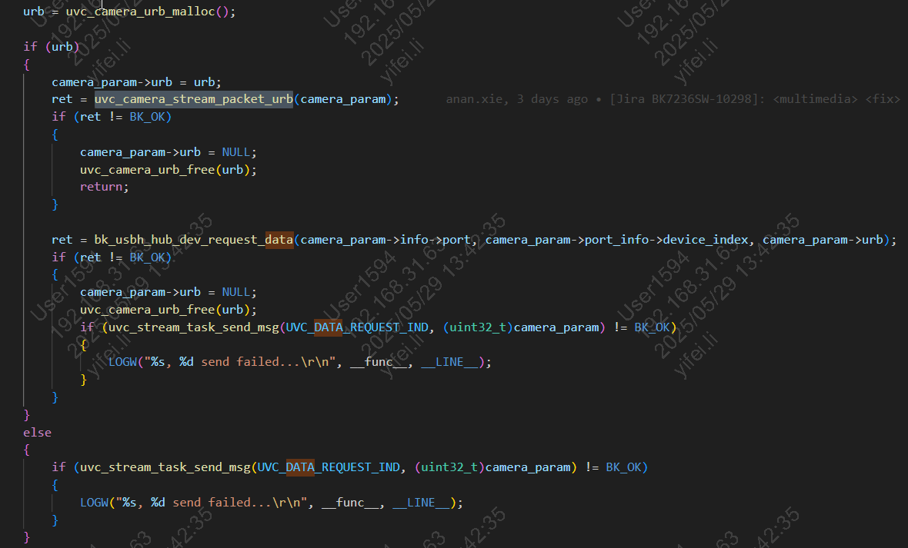
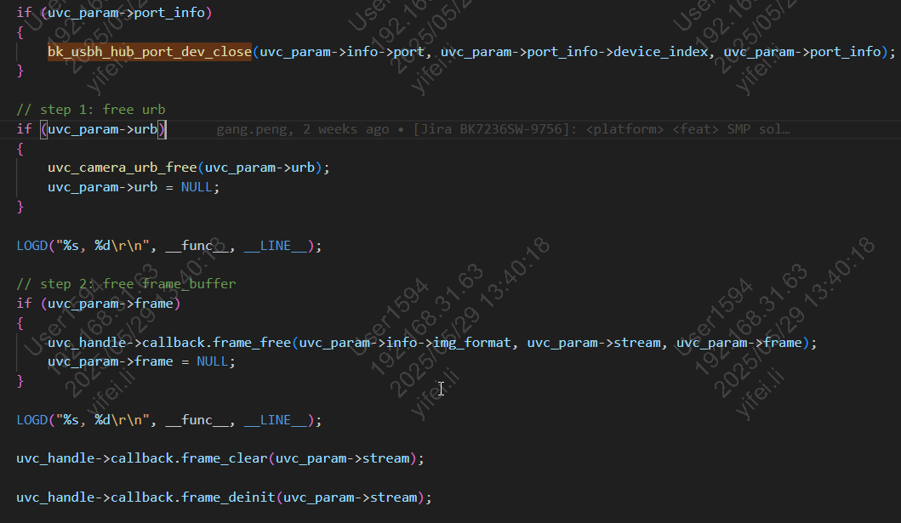

# USB Host UVC+UAC

bk_usbh_hub_multiple_classes_api是BK7258的 USB UVC + UAC 主机经过hub操作的程序，支持从 USB 设备读取/写入/控制多媒体流。当前最多同时支持 2 路摄像头 + 1 路麦克风 + 1 路播放器数据流。
具体的综合使用示例，请参考avdk多媒体代码，谢谢。

## UVC + UAC的宏定义配置

CONFIG_USB=y 打开USB的总开关宏定义 使能USB的代码功能

CONFIG_USB_VBAT_CONTROL_GPIO_ID=0x1C 默认使用的GPIO是GPIO_28进行USB Vbus电的控制，用户根据自己的实际情况进行配置

CONFIG_CHERRY_USB=y 默认使用的CherryUSB的开源代码，用户可根据实际情况进行版本的更新

CONFIG_USB_HOST=y 主程序作为HOST 对接口连接的设备进行枚举

CONFIG_TASK_USB_PRIO=2 USB的处理程序的TASK优先级配置为2

CONFIG_USBH_UVC=y 打开UVC的Host驱动

CONFIG_USBH_UAC=y 打开UAC的Host驱动

## UVC/UAC 主机驱动基本使用流程

UVC start/stop

## UVC 示例参考代码

代码请参考ap/components/bk_uvc/src/bk_uvc.c

作为HOST 运行Video设备为例，注册connect/disconnect回调函数,投票对usb上电，如下图所示：

UVC Connect/Disconnect

投上电票后，可以查看是否已经上电完成枚举到了当前Port的设备，若没有则需要等待Connect回调函数的上报。如下图所示：

UVC Check Param

Connect回调上报时，将设备的枚举信息及解析也会上报上来，如下图所示：

UVC Connect callback

先查验，枚举信息里的参数是否复合要求，然后建立通道，最后将其打开。如下图所示：

UVC Start

打开UVC之后，进行数据传输。先申请urb，对urb进行赋值，然后再用urb进行数据传输，如下图所示：

UVC Data Trans

使用完成之后，进行UVC关闭，然后再对内存进行释放，如下图所示：

UVC Stop

## UAC 主机驱动使用代码示例

代码请参考ap/components/bk_audio/audio_stream/uac_mic_stream.c
代码请参考ap/components/bk_audio/audio_stream/uac_speaker_stream.c
