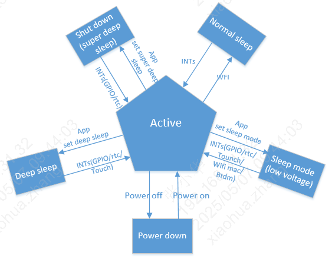

# 系统状态机说明

系统支持不同的睡眠模式:
:   - active

    - normal sleep

    - sleep mode(low voltage)

    - deep sleep

    - shut down(super deep sleep)

    - power down

支持的唤醒方式：

> | #sleep mode | GPIO | RTC | WIFImac | BTdm | TOUCH |
> | --- | --- | --- | --- | --- | --- |
> | normal sleep | Y | Y | Y | Y | Y |
> | sleep mode | Y | Y | Y | Y | Y |
> | deep sleep | Y | Y | N | N | Y |
> | super deep sleep | Y | Y | N | N | N |

备注

当前代码还定义了 `PM_WAKEUP_SOURCE_INT_VAD` 唤醒源，实际可用性取决于对应模块和平台配置。

## active(正常工作)

> - CPU处于工作状态且WIFI,BT可以正常收发数据。

## normal sleep(普通睡眠)

> - RTOS没有任务需要处理时，系统进入IDLE任务中，在IDLE任务中，CPU会进入WFI睡眠；当有任何中断到来时，都能让系统退出WFI状态，进入正常工作状态。

## sleep mode(睡眠模式)

> - 睡眠是一种相对比较节省功耗的睡眠模式。在该模式下系统只有32K时钟，此时只有部分硬件模块在工作，除了AON和部分模拟模块在工作，其他硬件模块是关闭的。
> - 睡眠模式AON的电压会降低，VDDDIG的电压0V。例如：如果SRAM不下电，在SRAM上保存的数据，处于保持中，睡眠唤醒后还能够继续使用。
> - 进入睡眠的条件:
>   - 1.RTOS没有任务需要处理时，系统进入IDLE任务中。
>   - 2.满足 `PM_ENTER_LOW_VOL_MODULES_CONFIG` 中配置的睡眠投票，应用层通常需要关注 `PM_SLEEP_MODULE_NAME_APP` 票；BT、WIFI等模块由SDK内部在合适时机投票。
> - 当唤醒信号触发后，系统退出睡眠状态，AON,VDDDIG电压会升到正常电压。
> - 处于睡眠状态下，以下唤醒源(GPIO,RTC,Touch,WIFI,BT)可以让系统退出睡眠。注意：WIFI,BT进入睡眠是根据WIFI，BT的业务场景来投票进入，投票比较特殊（SDK内部做好，应用程序不用关注），但是应用程序进入睡眠前需要把上层业务关闭。
> - 该模式下32K的时钟源可以根据自己业务的场景选择，时钟源可以参考 [时钟说明](bk_clock.md "bk_clock.md") 。
> - 为了达到最优功耗，不需要的模块，进入睡眠前请关闭，退出睡眠后，可以再开启。

## deep sleep(深度睡眠)

> - 深度睡眠是一种唤醒功能全且最节省功耗的睡眠模式。在该模式下系统只有32K时钟，只有AON和部分硬件模块在工作，其他硬件电路模块都下电。
>
>   当唤醒信号触发后，系统退出深度睡眠状态，系统复位。
> - 处于深度睡眠状态下，以下唤醒源(GPIO,RTC,Touch)可以让系统退出深度睡眠。

- 该模式下32K的时钟源以工程配置为准。当前BK7259 `PM_LPO_SOURCE` 默认配置为 `PM_LPO_SRC_DIVD` （26M分频得到32K），也可以通过工程配置选择外部32K或ROSC。

> - 进入深度睡眠的条件:
>   - 1.RTOS没有任务需要处理时，系统进入IDLE任务中;
>   - 2.满足 `PM_ENTER_DEEP_SLEEP_MODULES_CONFIG` 中配置的电源域关闭投票。当前默认配置为空，项目如新增深睡前必须关闭的电源域，应在该宏中增加对应模块并确保进入深睡前完成下电投票。

## shut down(超深度睡眠，又名super deep sleep)

待补充

## Power down(关机)

> - 整个系统下电

## 补充模式说明

> - `PM_MODE_FORCE_DEEP_SLEEP`：强制深度睡眠模式，适用于需要绕过普通模式选择逻辑、直接进入深睡流程的场景。
> - `PM_MODE_DEFAULT`：默认模式；RTOS进入IDLE后，如果满足睡眠模式票据则进入睡眠模式，否则进入普通WFI睡眠。

# 状态机切换说明

## 睡眠模式(sleep mode)说明

> - 睡眠模式和深度睡眠是系统性(整个芯片)睡眠，如果系统进入了睡眠模式和深度睡眠，个别模块还在工作，该模块的异常退出对系统从睡眠模式和深度睡眠中唤醒后，可能不能正常工作，
>   为了从机制上避免该问题的发生，则通过投票机制进入睡眠模式和深度睡眠。
> - 睡眠模式：当前进入睡眠模式的票由 `PM_ENTER_LOW_VOL_MODULES_CONFIG` 配置，BK7259默认配置包含 `PM_SLEEP_MODULE_NAME_I2C1` 到 `PM_SLEEP_MODULE_NAME_ENCP` 等37个模块，枚举最大支持到63：
>   - 1.BT和WIFI的票，BT和WIFI模块内部进入睡眠后自己投上，SDK内部做好，应用程序不用关注；
>   - 2.APP的票是提供给上层应用用，需要进入睡眠前，自己投上该票，唤醒后需要工作一段时间，则把该票取消，需要进入睡眠时，再投上。
>   - 3.多媒体(audio,video)的票，是关闭多媒体自动投上；
>   - 4.其他票默认是投上的。
>   - 5.对于SDK之外不需要关注太多，只需要关注APP这一张票。
> - 进入睡眠模式的条件
>   - 1.RTOS没有任务需要处理时，系统进入IDLE任务中;
>   - 2.满足 `PM_ENTER_LOW_VOL_MODULES_CONFIG` 中配置的睡眠模式票（如BT/WIFI进入sleep、多媒体关闭、APP票等）
>
>   如果进入睡眠模式失败，可以参考 [低功耗问题分析](bk_Lowpower_problem_analysis.md "bk_Lowpower_problem_analysis.md") 。

## 深度睡眠(deep sleep)说明

> - 深度睡眠：当前进入深度睡眠的电源域票由 `PM_ENTER_DEEP_SLEEP_MODULES_CONFIG` 配置:
>   - 1.由于深度睡眠唤醒后，系统会重启。
>   - 2.当前默认配置为空，即PM状态机不额外等待固定的BT/WIFI/audio/video电源域票。项目如需要约束某些模块必须关闭后才能进入深睡，需要在 `PM_ENTER_DEEP_SLEEP_MODULES_CONFIG` 中增加对应电源域模块。
>   - 3.即使默认深睡票为空，为了避免功耗异常或唤醒后外设状态异常，进入深睡前仍建议关闭上层业务和不需要的外设模块。
> - 系统中RTOS没有任务处理时，自动进入IDLE任务，进行WFI。当满足了进入深度睡眠条件（满足了进入深度睡眠的票时），则进入深度睡眠状态。
> - 进入深度睡眠的条件:
>   - 1.RTOS没有任务需要处理时，系统进入IDLE任务中;
>   - 2.满足 `PM_ENTER_DEEP_SLEEP_MODULES_CONFIG` 中配置的电源域票。
>
>   > 如果进入深度睡眠失败，可以参考 [低功耗问题分析](bk_Lowpower_problem_analysis.md "bk_Lowpower_problem_analysis.md") 。

## 超级深度睡眠(super deep sleep(shut down))说明

> - 超级深度睡眠：当前进入超级深度睡眠复用 `PM_ENTER_DEEP_SLEEP_MODULES_CONFIG` 配置的电源域票:
>   - 1.由于超级深度睡眠唤醒后，系统会重启。
>   - 2.当前默认配置为空，项目如需要约束某些模块必须关闭后才能进入超级深度睡眠，需要在 `PM_ENTER_DEEP_SLEEP_MODULES_CONFIG` 中增加对应电源域模块。
>   - 3.进入超级深度睡眠前仍建议关闭上层业务和不需要的外设模块。
> - 系统中RTOS没有任务处理时，自动进入IDLE任务，进行WFI。当满足了进入超级深度睡眠条件（满足了进入超级深度睡眠的票时），则进入超级深度睡眠状态。
>
>   - 进入深度睡眠的条件
>     - 1.RTOS没有任务需要处理时，系统进入IDLE任务中;
>     - 2.满足 `PM_ENTER_DEEP_SLEEP_MODULES_CONFIG` 中配置的电源域票。
>
>     如果进入超级深度睡眠失败，可以参考 [低功耗问题分析](bk_Lowpower_problem_analysis.md "bk_Lowpower_problem_analysis.md") 。

## 超级深度睡眠(super deep sleep)和深度睡眠的差异

> - 1.超深度休眠功耗更低，相比深度睡眠，额外把AON中数字逻辑电路也下电了。
> - 2.超深度休眠支持唤醒的GPIO只有GPIO_0到GPIO_15，深度睡眠对使用的GPIO没有限制。
> - 3.超深度休眠设置的RTC时间最大为1024s,深度休眠模式的RTC时间没有这个限制。
