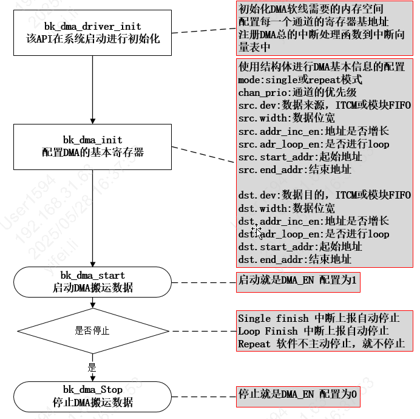
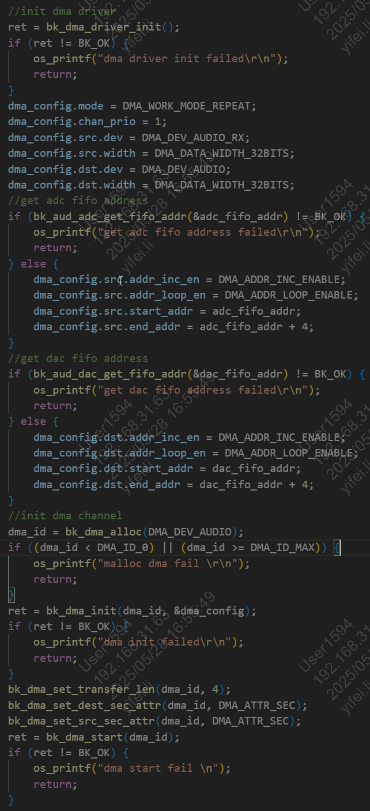
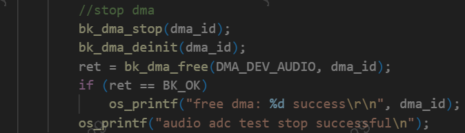
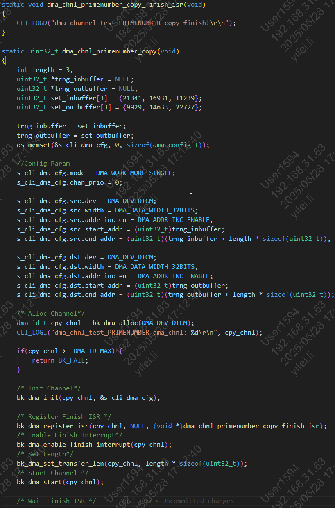

# DMA

## 1 基本DMA使用API调用流程及解析

基本流程为：初始化，配置，启动，等待中断，停止，如下图所示

Basic Process of DMA API

## 2 repeate模式从FIFO到SRAM的数据拷贝

Audio的FIFO和GDMA是相连的，可以进行源或目的地址的配置进行使用。

参考代码components/bk_cli/cli_aud.c，配置方法如下图所示配置：

DMA API Repeat Mode Config

参考代码components/bk_cli/cli_aud.c，配置方法如下图所示配置：

DMA API Repeat Mode Stop

备注

**Audio的FIFO和GDMA是相连的所以可以直接使用。若要确认使用的外设和FIFO是否与DMA相连，请查看dma_reg.h**

## 3 Single模式从SRAM到SRAM的数据拷贝

参考cli_dma.c的dma_chnl_primenumber_copy函数的实现。API的调用如下图所示：

DMA API Single Mode
