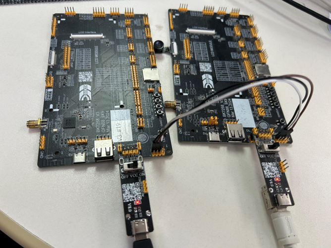

# UART


## 1 功能概述

> > UART (Universal Asynchronous Receiver and Transmitter) 通用异步接收器/发送器，用来实现不同设备之间的全双工或半双工数据交换。BK7258具有3个uart，目前uart0为cp侧独占使用（供log输出使用,ap侧禁止使用），ap侧仅支持使用uart1和uart2这两个uart。
>
> - UART相关的理论介绍参考: [UART的驱动](../../developer-guide/peripheral/bk_uart.md "../../developer-guide/peripheral/bk_uart.md")


## 2 代码路径

> - demo路径：
>   :   `ap\components\bk_cli\cli_uart.c`
> - 驱动源码路径：
>   :   `ap\middleware\driver\uart\uart_driver.c`
> - UART相关的api介绍参考: [UART的api介绍](../../api-reference/peripheral/bk_uart.md "../../api-reference/peripheral/bk_uart.md")


## 3 uart相关宏配置

> | NAME | Description | File | value |
> | --- | --- | --- | --- |
> | CONFIG_UART0 | UART0使能配置 | `ap\middleware\soc\bk7259_ap\bk7259_ap.defconfig` | n |
> | CONFIG_UART1 | UART1使能配置 | `ap\middleware\soc\bk7259_ap\bk7259_ap.defconfig` | n |
> | CONFIG_UART2 | UART2使能配置 | `ap\middleware\soc\bk7259_ap\bk7259_ap.defconfig` | n |
> | CONFIG_UART_PRINT_PORT | 配置打印输出log的UART口 | `ap\middleware\soc\bk7259_ap\bk7259_ap.defconfig` | 1 |
> | CONFIG_PRINTF_BUF_SIZE | 配置打印输出log的BUFFER大小 | `ap\middleware\soc\bk7259_ap\bk7259_ap.defconfig` | 256 |
> | CONFIG_KFIFO_SIZE | 配置UART对应软件FIFO的大小 | `ap\middleware\soc\bk7259_ap\bk7259_ap.defconfig` | 128 |
> | CONFIG_UART_ERR_INTERRUPT | UART使能错误中断 | `ap\middleware\soc\bk7259_ap\bk7259_ap.defconfig` | y |
> | CONFIG_UART_TX_DMA | 配置UART的DMA的TX功能即拷贝RAM数据到UART的FIFO | `ap\middleware\soc\bk7259_ap\bk7259_ap.defconfig` | n |
> | CONFIG_UART_RX_DMA | 配置UART的DMA的RX功能即从UART的FIFO数据拷贝到RAM | `ap\middleware\soc\bk7259_ap\bk7259_ap.defconfig` | n |
> | UART_RX_DMA_KFIFO_SIZE | 配置UART的RX的DMA的KFIFO的大小 | `ap\middleware\soc\bk7259_ap\bk7259_ap.defconfig` | 128 |


## 4 UART PIN脚描述

> - UART0对应开发板子上的uart0,且对应有1组PIN脚，对应的硬件管脚如下：
>
>   > | UART0功能 | 组0 |
>   > | --- | --- |
>   > | UART0_TX | GPIO11 |
>   > | UART0_RX | GPIO10 |
> - UART1对应开发板子上的uart1,且对应有1组PIN脚，对应的硬件管脚如下：
>
>   > | UART1功能 | 组0 |
>   > | --- | --- |
>   > | UART1_TX | GPIO0 |
>   > | UART1_RX | GPIO1 |
> - UART2对应开发板子上的uart2,且对应有1组PIN脚，对应的硬件管脚如下：
>   :   | UART2功能 | 组0 |
>       | --- | --- |
>       | UART2_RX | GPIO40 |
>       | UART2_TX | GPIO41 |


---


## 5 UART demo 配置

> - demo支持的命令如下表：
>
>   > | Command | | Param | Description |
>   > | --- | --- | --- | --- |
>   > | uart_driver {init|deinit} | | {init|deinit}: | init/deinit the uart resoure common |
>   > | uart {id} init [baud_rate] [data_bits]  [parity] [stop_bits] [flow_ctrl]  [src_clk] [rx_dma_en] [tx_dma_en] | | {id}:uart id,value range 1 ~ 2 | init uart and set working parameters |
>   > | {baud_rate}:uart baud rate |
>   > | {data_bits}: support value range 5 ~ 8 bits |
>   > | {parity}: support parity mode |
>   > | {stop_bits}:the stop bits len |
>   > | {flow_ctrl}: not support flow ctrl |
>   > | {src_clk}:uart working clock source |
>   > | {rx_dma_en}: enable uart rx dma |
>   > | {tx_dma_en}: enable uart tx dma |
>   > | uart_config  {id} | baud_rate {value} | {value}:support baud rate | set uart working parameters |
>   > | data_bits {value} | {value}:support value range 5 ~ 8 bits |
>   > | parity {value} | {value}:support parity none、 odd、 even |
>   > | stop_bits {value} | {value}:support 1 or 2 bits |
>   > | flow_ctrl {value} | {value}:support 0 or 1 |
>   > | rx_thresh {value} | {value}:support value range 0 ~ 255 bits |
>   > | tx_thresh {value} | {value}:support value range 0 ~ 255 bits |
>   > | rx_timeout{value} | {value}:support value range 0 ~ 3 bits |
>   > | uart_int {id} {enable|disable|reg} {tx|rx} | | {id}:uart id,value range 1 ~ 2 | enable|disable uart tx|rx interrupt and register uart tx|rx handler |
>   > | {enable|disable}:enable|disable tx|rx interrupt |
>   > | {tx|rx}: register tx|rx interrupt handler |
>   > | uart {id} {read|write}  {length} | | {id}:uart id,value range 1 ~ 2 | read specified length of data through uart |
>   > | {read|write}: read|write operation |
>   > | {length}: length to be read|write |

备注


-1.UART 模块的时钟源为 26M Hz，波特率是从 26M Hz 时钟源中分出的；


-2.计算方法为“除数 = （时钟源值 / 波特率）-1”。然后软件将除数值设置为 UART 寄存器；


-3.例如： 如果我们想设置波特率为 115200，则除数值为 = （26000000 / 115200）-1 == 224。软件将 224 设置为 UART 寄存器。因此，如果我们想设置其他波特率，只需计算除数值并将其设置为 UART 寄存器即可。（注意：除数值应该是整数类型）。


## 6 UART demo 命令行演示

> 1. 使用2块bk7258开发板，按照下图进行连接（建议两个板子共地，以免数据采样不准确）：



Figure 1. 将2块开发板通过UART对接

开始输入cli命令测试：

> 2. 启动开发板，对2块开发板分别输入初始化命令：
>
> > - 板1：(初始化命令)： **ap_cmd uart 1 init 115200 3 0 0 0 1 0 0**
> >
> >   > ```
> >   > [14:08:15.698]发→◇ap_cmd uart 1 init 115200 3 0 0 0 1 0 0
> >   > [14:08:15.713]收←◆ap_cmd uart 1 init 115200 3 0 0 0 1 0 0
> >   > os:I(378658):create shell_handle, tcb=28078f90, stack=[28077368-28078f68:7168], prio=5
> >   > $
> >   > $ap0:cli:I(378522):uart init, uart_id=1
> >   > ```
> > - 板1：(默认配置初始化)： **ap_cmd uart 1 init**
> >
> >   > ```
> >   > [14:07:04.565]发→◇ap_cmd uart 1 init
> >   > [14:07:04.565]收←◆ap_cmd uart 1 init
> >   > os:I(307518):create shell_handle, tcb=28078f90, stack=[28077368-28078f68:7168], prio=5
> >   > $ap0:cli:E(307382):invalid argc,use default config
> >   > ap0:cli:I(307382):uart init, uart_id=1
> >   > ```
> > - 板2：(或者以下命令)： **ap_cmd uart 1 init 115200 3 0 0 0 1 0 0**
> >
> >   > ```
> >   > [14:10:26.530]发→◇ap_cmd uart 1 init 115200 3 0 0 0 1 0 0
> >   > [14:10:26.546]收←◆ap_cmd uart 1 init 115200 3 0 0 0 1 0 0
> >   > os:I(455910):create shell_handle, tcb=28078f90, stack=[28077368-28078f68:7168], prio=5
> >   > $
> >   > $ap0:cli:I(455704):uart init, uart_id=1
> >   > ```
> > - 板2：(使用默认配置) **ap_cmd uart 1 init**
> >
> >   > ```
> >   > [14:10:22.823]发→◇ap_cmd uart 1 init
> >   > [14:10:22.839]收←◆ap_cmd uart 1 init
> >   > os:I(452206):create shell_handle, tcb=28078f90, stack=[28077368-28078f68:7168], prio=5
> >   > $
> >   > $ap0:cli:E(452000):invalid argc,use default config
> >   > ap0:cli:I(452002):uart init, uart_id=1
> >   > ```
> >
> > C） 板1 发送数据，板2接收数据；
> >
> > - 板1： **ap_cmd uart 1 write 10** //板1发送数据（其中，发送数据内容在测试代码中已自动赋值）
> >   :   ```
> >       [14:22:29.926]发→◇ap_cmd uart 1 write 10
> >       [14:22:29.941]收←◆ap_cmd uart 1 write 10
> >       os:I(15742):create shell_handle, tcb=28078f00, stack=[280772d8-28078ed8:7168], prio=5
> >       $ap0:cli:I(15608):uart write, uart_id=1, data_len:10
> >       ```
> > - 板2： **ap_cmd uart 1 read 10 0** //板2接收数据
> >   :   ```
> >       [14:22:32.722]发→◇ap_cmd uart 1 read 10 0
> >       [14:22:32.737]收←◆ap_cmd uart 1 read 10 0
> >       os:I(19678):create shell_handle, tcb=28078f00, stack=[280772d8-28078ed8:7168], prio=5
> >       $
> >       $ap0:cli:I(19546):uart read, uart_id=1, time_out:0 data_len:10
> >       ap0:cli:I(19546):recv_buffer[0]=0x0
> >       ap0:cli:I(19546):recv_buffer[1]=0x1
> >       ap0:cli:I(19546):recv_buffer[2]=0x2
> >       ap0:cli:I(19546):recv_buffer[3]=0x3
> >       ap0:cli:I(19546):recv_buffer[4]=0x4
> >       ap0:cli:I(19546):recv_buffer[5]=0x5
> >       ap0:cli:I(19546):recv_buffer[6]=0x6
> >       ap0:cli:I(19546):recv_buffer[7]=0x7
> >       ap0:cli:I(19546):recv_buffer[8]=0x8
> >       ap0:cli:I(19546):recv_buffer[9]=0x9
> >       ```
> >
> > D） 板2 发送数据，板1接收数据；
> >
> > > - 板2： **ap_cmd uart 1 write 20** //板2发送数据
> > >
> > > > ```
> > > > [14:25:43.416]发→◇ap_cmd uart 1 write 20
> > > > [14:25:43.416]收←◆ap_cmd uart 1 write 20
> > > > os:I(210366):create shell_handle, tcb=28078f90, stack=[28077368-28078f68:7168], prio=5
> > > > $
> > > > $ap0:cli:I(210232):uart write, uart_id=1, data_len:20
> > > > ```
> > >
> > > - 板1： **ap_cmd uart 1 read 20 0** //板1接收数据
> > >
> > > > ```
> > > > [14:25:48.436]发→◇ap_cmd uart 1 read 20 0
> > > > [14:25:48.436]收←◆ap_cmd uart 1 read 20 0
> > > > os:I(214244):create shell_handle, tcb=28078f90, stack=[28077368-28078f68:7168], prio=5
> > > > $
> > > > $ap0:cli:I(214110):uart read, uart_id=1, time_out:0 data_len:20
> > > > ap0:cli:I(214110):recv_buffer[0]=0x0
> > > > ap0:cli:I(214110):recv_buffer[1]=0x1
> > > > ap0:cli:I(214110):recv_buffer[2]=0x2
> > > > ap0:cli:I(214110):recv_buffer[3]=0x3
> > > > ap0:cli:I(214110):recv_buffer[4]=0x4
> > > > ap0:cli:I(214110):recv_buffer[5]=0x5
> > > > ap0:cli:I(214110):recv_buffer[6]=0x6
> > > > ap0:cli:I(214110):recv_buffer[7]=0x7
> > > > ap0:cli:I(214110):recv_buffer[8]=0x8
> > > > ap0:cli:I(214110):recv_buffer[9]=0x9
> > > > ap0:cli:I(214110):recv_buffer[10]=0xa
> > > > ap0:cli:I(214110):recv_buffer[11]=0xb
> > > > ap0:cli:I(214110):recv_buffer[12]=0xc
> > > > ap0:cli:I(214110):recv_buffer[13]=0xd
> > > > ap0:cli:I(214110):recv_buffer[14]=0xe
> > > > ap0:cli:I(214110):recv_buffer[15]=0xf
> > > > ap0:cli:I(214110):recv_buffer[16]=0x10
> > > > ap0:cli:I(214110):recv_buffer[17]=0x11
> > > > ap0:cli:I(214110):recv_buffer[18]=0x12
> > > > ap0:cli:I(214110):recv_buffer[19]=0x13
> > > > ```
