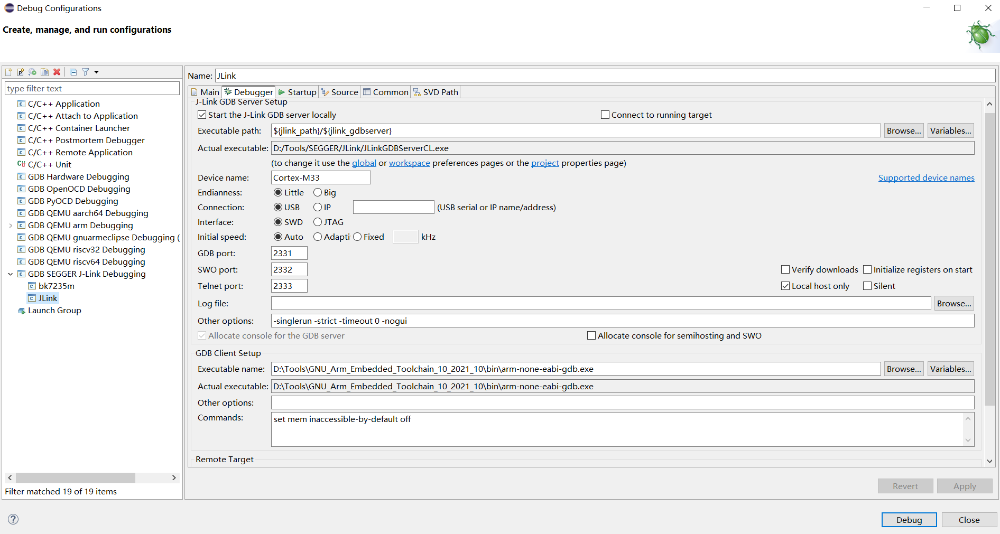
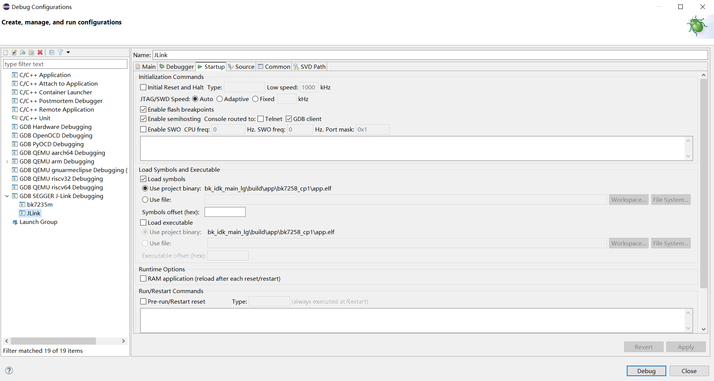
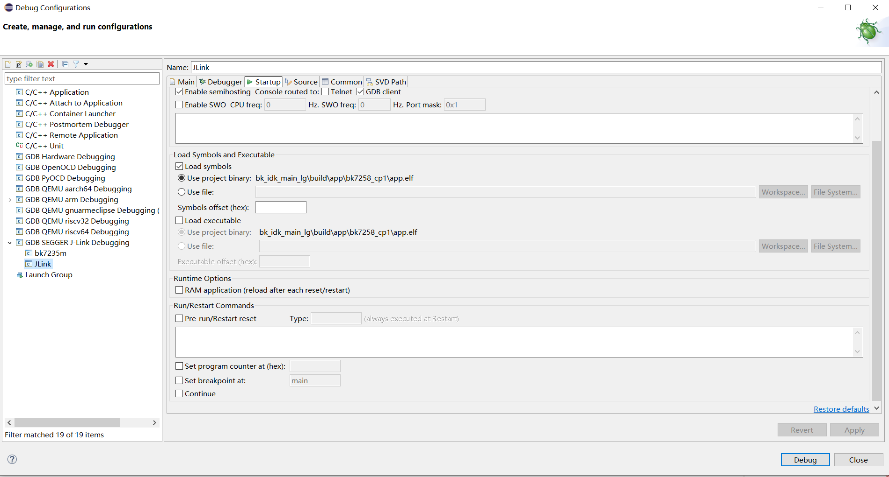
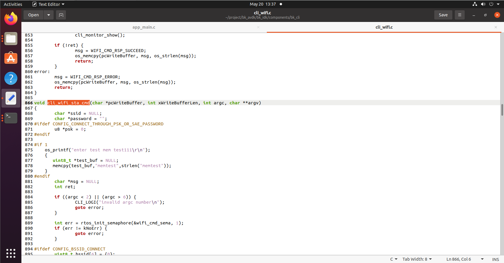
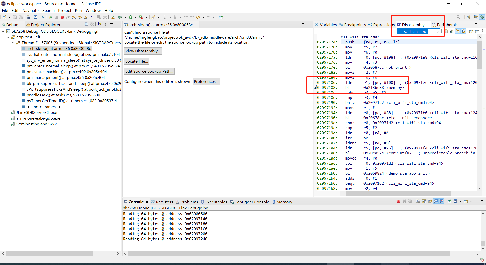
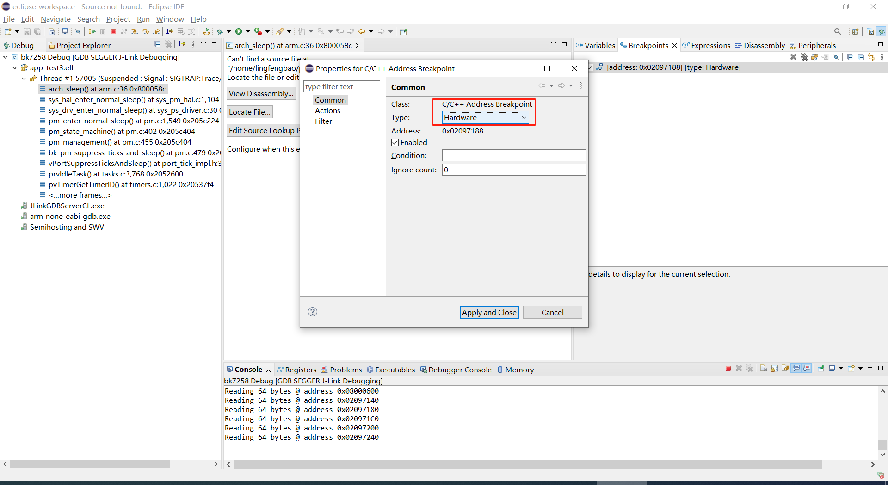
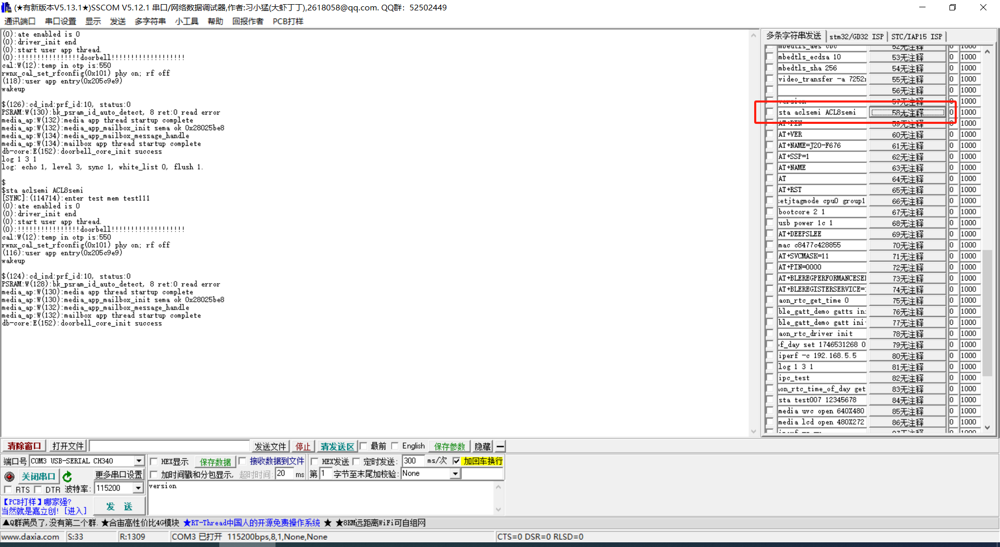
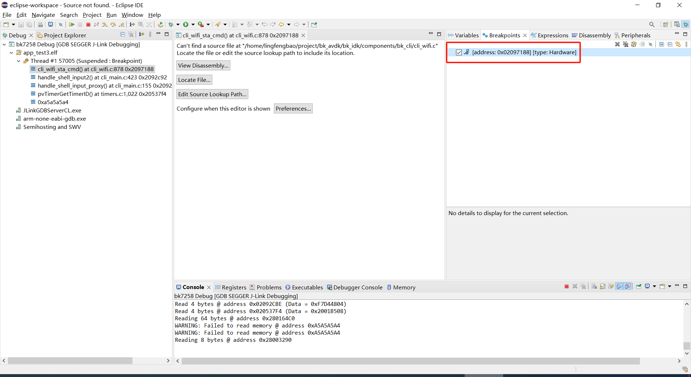

# 系统调试


## **Armino平台CP系统调试命令**

BK7259 为 CP+AP 双系统架构。日常调试串口接在 CP 侧（`bk7259` defconfig 默认
`CONFIG_UART_PRINT_PORT=0`，即 DL_UART0，波特率 115200）。CP 命令直接在串口输入；
AP 命令需加 `ap_cmd` 前缀由 CP 转发。


### 日志输出

详细机制见 [系统日志](error_log/bk_log.md "error_log/bk_log.md")，此处仅列与调试相关的要点：


- CP 侧 log 默认经 DL_UART0 直出；AP 侧 log 默认经 mailbox 转发到 CP，在同一串口
  混合输出。

- 正常运行时 log 前缀：CP 为 cpu0 与 cpu1（CP SMP 时），AP 为 ap0 与 ap1（逻辑
  CPU2 与 CPU3）；异常 dump 不带此前缀。

- 异步 log 默认开启 `CONFIG_SHELL_ASYNCLOG`；缓存耗尽时出现 `INSRT:` 插入式输出。
  可用 `log [echo] [level] [sync] [whitelist]` 分别调整 CP 侧配置；AP 侧用
  `ap_cmd log` 调整。


### 串口 CLI

CP 侧内置命令（直接在 CP 串口输入）：


```
help
log
log 1 3 0
memshow
backtrace
setswdmode
ap_cmd help

```

备注

旧版 cpu1 命令已改为 ap_cmd（见 cli_cpu1_command）。实际可用命令随工程
menuconfig 变化，以 help 与 ap_cmd help 实时输出为准，不要依赖静态命令列表。

常见 CP 调试命令（直接输入）包括：

| 命令 | 说明 |
| --- | --- |
| `help` / `log` / `loginfo` / `modlog` | 命令列表、log 级别与模块 tag 过滤 |
| `memshow` / `memleak` / `backtrace` / `tasklist` / `osinfo` | CP 堆内存、任务与运行时信息（见本文末「CP 内置调试特性」） |
| `setswdmode` / `setprintport` | 进入 SWD 模式、切换 log/shell 串口（见下文 SWD 章节） |
| `ap_cmd <cmd>` | 将命令转发到 AP shell（如 `ap_cmd memshow`、`ap_cmd dwtf 100`） |


### ATE 模式下的 UART 切换（可选）

若工程启用 ATE 相关配置，可通过以下宏指定 ATE 检测管脚与 log 口切换行为：


- `CONFIG_UART_ATE_PORT`：ATE 模式检测管脚

- `CONFIG_UART_PRINT_PORT`：正常运行时 log UART

- `CONFIG_UART_ATE_PRINT_PORT`：进入 ATE 后切换到的 log UART

示例：ATE 用 UART1 TX 识别，正常运行 log 走 UART1，进 ATE 后 log/命令行走 UART0:


```
CONFIG_UART_ATE_PORT=1
CONFIG_UART_PRINT_PORT=1
CONFIG_UART_ATE_PRINT_PORT=0

```


## **DWT 调试 (Data Watchpoint and Trace)**


### 功能简介

DWT（Data Watchpoint and Trace）是 ARM Cortex-M 内核内置的调试单元，可在**不连接 JLink 等外部调试器**的情况下，
通过串口 CLI 实现类似硬件断点 / watchpoint 的调试能力。

主要功能包括：


- **数据 watchpoint**：监控指定内存地址的读、写或读写访问（SMP 下 `dwtdw`；非 SMP 下 `dwtd r/w/b`）

- **数据范围 watchpoint**：监控一段连续地址范围内的写操作（`dwtdr`，仅非 SMP 模式）

- **条件 watchpoint**：仅当向某地址写入特定值时才触发（`dwtdd`）

- **指令 watchpoint**：监控 CPU 执行到某条指令地址时触发（`dwti`，类似硬件断点）

备注

AP 侧（SMP 模式）另提供 `dwtf` 命令，利用 DWT 周期计数器（CYCCNT）测量 CPU 频率；CP 侧无此命令。

典型应用场景：


- 定位「谁在什么时候改写了某个变量」

- 监控关键标志位被写成特定值的时机

- 确认某段代码是否被执行


### 软件架构

CP 侧调用链路:


```
串口 CLI (cli_dwt.c)
    → DWT 驱动 (cp/middleware/arch/cortex-m/dwt.c)
    → 配置 DWT 比较器 + 开启 Debug Monitor 模式
    → 命中时触发 DebugMon 异常
    → soc_debugmon_handler() → dump 系统信息

```

AP 侧调用链路类似，源码位于 `ap/components/bk_cli/cli_dwt.c` 和 `ap/middleware/arch/cortex-m/dwt.c`。
SMP 模式下数据 watchpoint 会通过 IPI 同步到各核；AP 侧另提供 `dwtf` 频率测量命令。


### 工作原理

1. 通过 `DCB->DEMCR` 开启 Debug Monitor 模式（`MON_EN`）和 DWT 跟踪（`TRCENA`）
2. 配置 DWT 比较器（`COMP0~3` + `FUNCTION0~3`）设置监控条件
3. 当 CPU 访问/执行命中条件时，产生 Debug Event
4. 进入 Debug Monitor 异常（异常号 12），平台默认 handler 会 dump 寄存器、backtrace 和内存

备注

DWT CLI 使用的是 Debug Monitor 模式（无需 halt CPU），与 JLink SWD Halt 调试模式不同。
两者同时使用时可能冲突，建议按需选择其一。


### CP SMP 差异

BK7259 CP 同样支持 SMP（`CONFIG_SOC_SMP=y`）。开启 SMP 后，数据 watchpoint（`dwtdw`/`dwtdd`）会通过 IPI 同步到所有核，
确保任意核上的匹配访问都能被捕获。指令 watchpoint（`dwti`）仅在执行 CLI 命令的核上生效。

与 AP 的区别：CP 侧不提供 `dwtf` 频率测量命令；非 SMP 配置下可用 `dwtd`/`dwtdr` 提供更细粒度的数据 watchpoint 类型。


### CLI 命令 (cli_dwt)

CP 侧 `cli_dwt.c` 实现了与 AP 类似的 DWT CLI 封装，但默认不在 `bk_cli_init()` 中调用 `cli_dwt_init()`，串口 shell 不会注册这些命令。DWT CLI 调试建议在 AP 侧使用。


### 编译与注册条件


- `CONFIG_CLI=y`、`CONFIG_ARCH_CORTEX_M=y`：编译 `cli_dwt.c`

- CP 默认不注册 DWT 命令；若需启用，在 `bk_cli_init()` 中自行调用 `cli_dwt_init()`


### 命令列表

SMP 模式（`CONFIG_SOC_SMP=y`，多数工程默认开启）：

| 命令 | 格式 | 功能 |
| --- | --- | --- |
| `dwtdw` | `dwtdw 0x<addr>` | 监控指定地址被写入（IPI 同步各核） |
| `dwtdd` | `dwtdd 0x<addr> 0x<value>` | 监控向地址写入指定值（IPI 同步各核） |
| `dwti` | `dwti 0x<instruction_addr>` | 监控指令地址被执行 |

非 SMP 模式（`CONFIG_SOC_SMP=n`）：

| 命令 | 格式 | 功能 |
| --- | --- | --- |
| `dwtd` | `dwtd r/w/b 0x<addr>` | 监控数据地址读(r)/写(w)/访问(b) |
| `dwtdr` | `dwtdr 0x<addr> 0x<limit>` | 监控数据地址范围内的写操作 |
| `dwtdd` | `dwtdd 0x<addr> 0x<value>` | 监控向地址写入指定值 |
| `dwti` | `dwti 0x<instruction_addr>` | 监控指令地址被执行 |


### 参数格式


- 地址和数值参数必须使用 `0x` 前缀的十六进制格式，例如 `0x281a9070`

- 非 SMP 模式下，`dwtd` 的第一个参数为访问类型字符 r/w/b，分别表示读、写、读或写


### 使用示例

SMP 模式下设置数据写 watchpoint 并触发 dump（触发写内存可用 memset_pattern；
memset 需 `CONFIG_DEBUG_VERSION`）:


```
memshow
dwtdw 0x281a9070
memset_pattern 0x281a9070 0x4 0x55

```

非 SMP 模式下设置数据写 watchpoint:


```
dwtd w 0x281a9070
memset_pattern 0x281a9070 0x4 0x55

```

非 SMP 模式下监控地址范围写入:


```
dwtdr 0x281a9070 0x281a9080
memset_pattern 0x281a9075 0x4 0xAA

```

设置条件 watchpoint（仅匹配值时触发）:


```
dwtdd 0x281a9070 0xAABBCCDD
memset_pattern 0x281a9070 0x4 0x11        # 不匹配，不 dump
memset_pattern 0x281a9070 0x4 0xAABBCCDD  # 匹配，触发 dump

```

设置指令 watchpoint（需已知函数地址，可从 map/elf 获取）:


```
dwti 0x64f691ec
memset_pattern 0x281a9070 0x4 0x55

```


### 注意事项


- watchpoint 触发后会进入 Debug Monitor 异常并 dump 系统信息（`RESET_SOURCE_DEBUG_MONITOR_FAULT`），系统可能重启

- watchpoint 设置后一直有效，直到系统重启；无 CLI 清除命令

- 不要在 `rtos_disable_int()` 临界区（PRIMASK=1）内依赖 DWT watchpoint：PRIMASK 会屏蔽 Debug Monitor 异常，命中事件会被丢弃，开中断后也不会补触发

- 同时连接 JLink SWD halt 调试时，可能与 Debug Monitor 模式冲突，建议二选一


## **Armino平台CP系统swd调试**

cp系统支持在线调试，使用jlink工具及Eclipse上位机工具，即可快速搭建调式环境。

> - JLink环境通过Eclipse集成JLink gdb server + gdb 工具
> - Jlink和BK7259连线:
>
>   ```
>   1# VTref  ---- VREF
>   7# SWDIO  ---- SWDIO
>   9# SWCLK  ---- SWCLK
>   20# GND   ---- GND
>   ```
> - JLink软件版本
>   [https://www.segger.com/downloads/jlink/JLink_Windows_V768_x86_64.exe](https://www.segger.com/downloads/jlink/JLink_Windows_V768_x86_64.exe "https://www.segger.com/downloads/jlink/JLink_Windows_V768_x86_64.exe")
> - Arm工具链版本
>   [https://armkeil.blob.core.windows.net/developer/Files/downloads/gnu-rm/10.3-2021.10/gcc-arm-none-eabi-10.3-2021.10-win32.exe](https://armkeil.blob.core.windows.net/developer/Files/downloads/gnu-rm/10.3-2021.10/gcc-arm-none-eabi-10.3-2021.10-win32.exe "https://armkeil.blob.core.windows.net/developer/Files/downloads/gnu-rm/10.3-2021.10/gcc-arm-none-eabi-10.3-2021.10-win32.exe")
> - Eclipse版本
>   eclipse-embedcpp-2020-12-R-win32-x86_64.zip
> - Eclipse工程配置
>
> > 
> >
> > 
> >
> > 
>
> - 默认swd连接CP端，使用第一组SWD管脚(GPIO20=SWCLK，GPIO21=SWDIO)
> - 打开 `CONFIG_SWD_DEBUG_MODE` 后，开机启动过程或进入异常(HardFault/NMI等)时会自动进入SWD调试模式，无需输入命令即可用Trace32或JLink连接
> - 也可以在运行时通过 `setswdmode` 命令手动进入SWD调试模式
> - 可以通过jtagmode命令查看当前jtag/swd状态

备注

使用Jlink/Trace32进行SWD调试连接，需要打开 `CONFIG_SWD_DEBUG_MODE` (或编译DEBUG版本)。

`bk_set_swd_mode()` 不再需要传入cpu id和管脚组号，调用后会：


- 将调试端口路由到CP端(CPU0)

- 关闭 AON WDT / WWDT / Task WDT，避免调试器halt住CPU时被看门狗复位

- 把SWD管脚重新配置为SWD功能(默认GPIO20=SWCLK，GPIO21=SWDIO)

该接口只做寄存器级配置，因此在驱动尚未初始化(开机早期或异常处理上下文)时也可以安全调用。


**自定义SWD管脚**：打开 `CONFIG_SWD_DEBUG_MODE` 后，可通过以下两个配置项让客户自定义SWD的GPIO：


- `CONFIG_SWD_DEBUG_MODE_PIN_CLK`：SWCLK使用的GPIO编号(默认20)

- `CONFIG_SWD_DEBUG_MODE_PIN_DIO`：SWDIO使用的GPIO编号(默认21)

`bk_set_swd_mode()` 会读取这两个配置；若客户把管脚改到非默认位置，会先释放默认的GPIO20/21再映射到新的管脚。

如果是开机异常想要在某处停下来等待JLink接入，可以在代码中调用:


```
bk_set_swd_mode();
while (g_test_mode); // 定义一个volatile全局变量，而不是while(1)，防止编译器把后面的代码优化掉

```

然后接入JLink/Trace32后，修改g_test_mode变量值，开始往下调试。

若需要使用非默认管脚，可直接调用 `gpio_swd_sel(swclk, swdio)` 指定SWCLK/SWDIO对应的GPIO。


### swd调试示例

连接好jlink后，可以按照以下步骤打断点调试：


- 根据函数指针或者函数名在Disassembly页找到dump的地址



示意图1



示意图2


- 在dump函数之前的语句设置断点，将断点属性设置为hardware



示意图3


- 点击resume继续运行程序。运行错误代码，如我在sta命令里，加了错误代码



示意图4


- 程序在断点处停下



示意图5


## **Armino平台异常dump一键恢复现场工具**

> - 请参考发布工具中使用文档:
>   [https://dl.bekencorp.com/d/tools/Debug_tool/bk_coredump_tools.zip](https://dl.bekencorp.com/d/tools/Debug_tool/bk_coredump_tools.zip "https://dl.bekencorp.com/d/tools/Debug_tool/bk_coredump_tools.zip")
> - BK7259 dump工具常见问题:
>
>   - Kconfig 中 `CONFIG_DUMP_ENABLE` 默认关闭；`bk7259` / `bk7259_ap` 的
>     defconfig 已将其设为 `y`。若自定义工程关闭了 dump，需在 CP/AP 两侧
>     menuconfig 的 Coredump 中分别重新打开
>   - 当前架构为 CP+AP，可在两侧 config 中分别打开 dump
>   - Dump 工具通过解析 log 中的 regs、内存段等内容恢复现场（详见工具包文档）
>   - Log 后缀支持 txt、log、DAT；编码仅支持 utf-8
>   - 工具目录下应只保留一份 Log，且 Log 中只含一次完整 dump（否则取最后一次）
>   - 工具可自动去掉规则时间戳 `[2024-02-03 14:35:13.375193]`，不规则时间戳需手动删除
>   - 若 dump 过程中连续两次异常（如越界检测触发 Assert），解析时需删掉第二次寄存器打印
>   - 单次 dump 会输出当前核寄存器、ITCM、DTCM、SRAM 分区、栈、外设寄存器及 EXTRA_MEM 等
>   - 默认 CP 侧 Log/Dump 经 UART0 输出；AP 侧经 MAILBOX 转发到 CP 再经 UART0 输出
>   - 多核同时 dump 时需按核拆分 Log，分别用 CP/AP 的 elf 恢复
>
>     > dump 日志头部示例:
>     >
>     > ```
>     > @Dump-reason: MemFault
>     > build time => Jan 01 2026 12:00:00 !
>     > SMP-Core-id:0
>     > ```
>     >
>     > 寄存器格式（`CPU%d` 为异常核编号，与 `SMP-Core-id` 对应）:
>     >
>     > ```
>     > CPU0 Current regs:
>     > 0 r0 x 0x0
>     > 1 r1 x 0x28061ca0
>     > ...
>     > 14 sp x 0x20000928
>     > 15 lr x 0x21ec909
>     > 16 pc x 0x21ec8fa
>     > 17 xpsr x 0x61000000
>     > 18 msp x 0x2808ff48
>     > 19 psp x 0x20000908
>     > 20 primask x 0x0
>     > 21 basepri x 0x0
>     > 22 faultmask x 0x0
>     > 23 fpscr x 0x0
>     > 31 ER x 0xfffffffd
>     > 32 control x 0xc
>     > 40 MMFAR x 0x8061ca0
>     > 41 BFAR x 0x8061ca0
>     > 42 CFSR x 0x82
>     > 43 HFSR x 0x0
>     > 44 DFSR x 0x0
>     > 45 AFSR x 0x0
>     > 46 SHCSR x 0x0
>     > 47 ICSR x 0x0
>     > 48 VTOR x 0x28000000
>     > 49 MSPLIM x 0x0
>     > 50 PSPLIM x 0x0
>     > Traceback:
>     >     arm-none-eabi-addr2line -piaf -e app.elf 0x21ec8fa 0x21ec909 ...
>     > ```
>
>   备注
>
>   相较旧版 dump：寄存器新增 ``` 31 ER``（异常 LR）、``44 ```–`50` 故障/系统寄存器；
>   去掉旧版 `30 CPUx xPSR` 行；内存段 header 增加 `region` 字段。
>
>   内存编码由 `CONFIG_DUMP_UART_MEM_ENCODING_BASE64` 与
>   `CONFIG_DUMP_UART_MEM_ENCODING_ASCII` 二选一（BK7259 defconfig 默认 Base64）。
>
>   内存段格式（Base64，默认）:
>
>   ```
>   >>>>stack mem dump begin, region: SRAM0, stack_top=28040000, stack end=28060000
>
>   <每行 32 字节数据的 Base64 编码，末尾含 CRC>
>
>   <<<<stack mem dump end. region: SRAM0, stack_top=28060000, stack end=28060000
>   ```
>
>   内存段格式（ASCII，可选）:
>
>   ```
>   >>>>stack mem dump begin, region: DTCM, stack_top=20000000, stack end=20004000
>
>   00 01 02 03 04 05 06 07 ...
>
>   <<<<stack mem dump end. region: DTCM, stack_top=20004000, stack end=20004000
>   ```
>
>   BK7259 常见 `region` 名称：`DTCM`、`ITCM`、`SRAM0`–`SRAM6`、
>   `mstack`、`pstack`、`EXTRA_MEM`、`MEM_CHECK` 及各外设寄存器块。
>
>   - 当系统打开 CONFIG_MEM_DEBUG 时，Dump 过程会将当前系统正在使用的 Heap 内存全部
>     打印出来，并检查是否有内存越界:
>
>     ```
>     tick       addr         size   line    func                               task
>     --------   ----------   ----   -----   --------------------------------   ----------------
>     6976       0x28064b68   80     425     xQueueGenericCreate                media_ui_task
>     6976       0x28064be0   80     425     xQueueGenericCreate                media_ui_task
>     ```
>   - 正常情况下也会将 task 相关信息 dump 到日志，供问题分析时参考


## **Armino平台系统稳定性问题分析**

嵌入式稳定性问题是一类常见但不容易定位的问题，其具有以下特征：

> - 不可预测性：系统故障的时间点不固定，难以预测，可能在长时间运行后突然发生
> - 多样性：问题可能以崩溃、死机、卡顿或错误行为等多种形式出现
> - 累计效应：系统运行时间越长，资源泄漏或数据损坏等问题可能积累，最终导致崩溃
> - 环境依赖性：稳定性还可能受温度、湿度和电源波动等环境因素的影响

为了帮助用户更好的定位稳定性问题，下面的链接文档中提供了常见的分析手段

备注

> 本文档仅针对软件引起的稳定性问题,建议用户在碰到稳定性问题时，优先参考该文档


- 文档 [下载链接](https://dl.bekencorp.com/tools/system_debug/稳定性问题软件分析.pdf "https://dl.bekencorp.com/tools/system_debug/稳定性问题软件分析.pdf")

- 文档内容说明:


  - 文中介绍了系统调试相关的工具，请参考上述章节

  - 文中列举了系统可能出现异常的各种场景

  - 文中还列举了一些经典的稳定性问题的分析案例


## **CP 内置调试特性**

本节按功能说明 CP 侧内置调试能力的作用与查看方式。命令在 CP 串口直接输入，无需
`ap_cmd` 前缀。DWT 数据观察点见上文 DWT 章节，此处不重复。


### 1. 堆内存分配跟踪（CONFIG_MEM_DEBUG）


#### 作用

每次 `os_malloc()` / `pvPortMalloc()` 等分配时，在块头记录分配函数、行号、
任务名、分配 tick、请求大小；块尾填充 `0xcd` 用于检测写越界。可用于排查内存
泄漏、崩溃时存活堆块定位等。`bk7259` defconfig 默认 `CONFIG_MEM_DEBUG=y`。


#### 如何查看


```
memshow
memleak
memleak 60
osinfo

```

开启 `CONFIG_DUMP_ENABLE` 后，MemFault 或 Assert 的串口日志中会自动附带与
`memleak` 相同格式的堆列表。


### 2. Task 切换记录（Task Recorder）


#### 作用

每次任务切换时，把当前核上最近 10 次调度快照写入环形缓冲（tick、时间、TCB、栈指针
等），用于分析崩溃前的调度顺序与栈余量。SMP 下符号名为 `s_task_recorder_core0[]`、

``` s_task_recorder_core1[]``（``cp/components/os_source/freertos_smp_v2p0 ```）。


#### 开启配置


**Armino Configuration** → **Compiler Options** → `CONFIG_DEBUG_VERSION=y`
（`bk7259` defconfig 默认关闭）。


#### 如何查看


```
tasklist
backtrace

```

无专用 CLI 逐条打印。异常 dump 后结合 `app.map` 中的 recorder 地址，在 Eclipse

**Memory** 或 **Expressions** 窗口查看结构体字段。


### 3. 中断记录（Interrupt Recorder）


#### 作用

在每个 CPU 核上记录最近若干次中断的进入/退出时间与 IRQ 号，并统计 ISR 耗时与
中断静默窗口。适用于 Wi-Fi/BLE 中断异常、系统卡死、怀疑关中断过久等场景。


#### 开启配置


**Arch** → **Cortex-M** → **Modify Arch Config**：


```
CONFIG_INTERRUPT_DEBUG_RECORDER=y          # bk7259 defconfig 默认已开
CONFIG_INTERRUPT_RECORDER_CNT=40
CONFIG_INTERRUPT_GAP_DETECT_US=50000

```

实现位于 `cp/middleware/driver/bk7259/interrupt.c`；plat dump 符号为
`s_interrupt_core0_dump`、`s_interrupt_core1_dump`。


#### 如何查看


**崩溃后**：在 dump 日志 `EXTRA_MEM` 段定位上述符号，用 Eclipse Memory 窗口查看
`recorder[]`、`max_gap_us` 等字段。


**运行期**：可调用 `bk_interrupt_dump_recorder()` 串口文本输出（异常 dump 路径中
默认未启用）。
