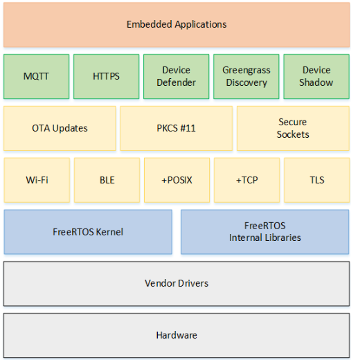

# FreeRTOS 操作系统

## 概述

> - FreeRTOS 是一个迷你的实时操作系统内核。
> - 作为一个轻量级的操作系统，功能包括：任务管理、时间管理、信号量、消息队列、内存管理、记录功能、软件定时器、协程等，可基本满足较小系统的需要。
> - FreeRTOS 能在小 RAM 单片机上运行，是完全免费的开源操作系统，具有源码公开、可移植、可裁减、调度策略灵活的特点，可以方便地移植到各种单片机上运行。
> - Armino 平台 CP 侧使用内核路径 `components/os_source/freertos_v10`，版本基于 FreeRTOS Kernel V10.4.x 系列。
> - BK7259 CP 子系统支持双核（CPU0/CPU1），多核协同与 hotplug 说明见 [开发者指南](../developer-guide.md "../developer-guide.md")。

## 通用架构

> - 一个 FreeRTOS 系统主要由 BSP 驱动、内核与组件组成。内核包含多任务调度、内存管理与任务间通信；组件包含网络协议、外设支持等。
> - FreeRTOS 内核与组件均可剪裁。嵌入式应用对内存空间要求苛刻，可剪裁 RTOS 非常重要，这使得 FreeRTOS 核心代码仅约 9000 行。

FreeRTOS 架构

## 功能与特点

> - 用户可配置内核功能
> - 多平台的支持
> - 提供一个高层次的信任代码的完整性
> - 目标代码小，简单易用
> - 遵循 MISRA-C 标准的编程规范
> - 强大的执行跟踪功能
> - 堆栈溢出检测
> - 没有限制的任务数量
> - 没有限制的任务优先级
> - 多个任务可以分配相同的优先权
> - 队列，二进制信号量，计数信号灯和递归通信和同步的任务
> - 优先级继承
> - 免费开源的源代码

## 小结

> - 作为一个轻量级的操作系统，FreeRTOS 提供的功能包括：任务管理、时间管理、信号量、消息队列、内存管理、记录功能等，可基本满足较小系统的需要。FreeRTOS 内核支持优先级调度算法，每个任务可根据重要程度被赋予一定的优先级，CPU 总是让处于就绪态的、优先级最高的任务先运行。FreeRTOS 内核同时支持轮换调度算法，系统允许不同的任务使用相同的优先级，在没有更高优先级任务就绪的情况下，同一优先级的任务共享 CPU 的使用时间。
> - FreeRTOS 的内核可根据用户需要设置为可剥夺型内核或不可剥夺型内核。
> - 在嵌入式领域，FreeRTOS 同时具有实时性、开源性、可靠性、易用性、多平台支持等特点。

## API 介绍

通常情况下，应用层不应直接调用内核 API，而应调用 SDK 中 OS 抽象层提供的接口。CP 侧实现位于 `components/bk_rtos/freertos/v10/rtos_pub.c`，头文件为 `include/os/os.h`。

具体可参考：

> - [OS 抽象层](bk_os_abstract.md "bk_os_abstract.md")
> - [内存接口](bk_mem.md "bk_mem.md")
