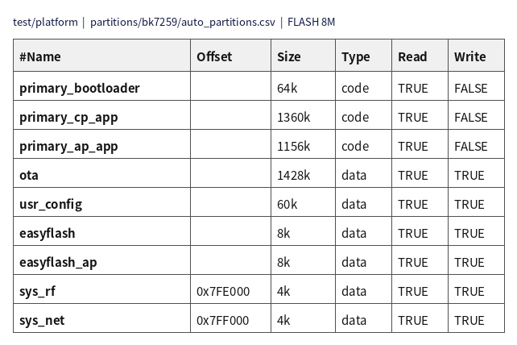

# 新建project规则简介

备注

创建新的 project 规则主要分为以下几个部分，以 bk7259 的 test/platform 工程为例，将详细介绍如何新建工程。

- 1、分区表的配置；

- 2、config 文件中配置宏的修改；

## 分区表的配置

分区表的配置为 CSV 文件，以 bk7259 的 test/platform 工程为例，`partitions/bk7259/auto_partitions.csv` 其格式如下：

> 
>
>
> 图1 partition_layout
>
> BK7259 默认 **不在 Flash 中为 code 分区额外插入 CRC** （`Flash_CRC_ENABLE` 未开启时），Flash 占用空间即为 CSV 中配置的 `Size`，不再按旧版 34/32 倍膨胀。
>
> - `Name` - 分区表命名为：auto_partitions.csv；分区表固定为 6 列，其中 Name 列为必选项且须唯一，表示分区的名字；
>
>   - 构建时会根据分区的名字来生成唯一的宏定义，代码中会操作该宏定义来访问相关的分区；
>   - 编译生成的二进制文件名，也是根据该分区名字来命名，如 primary_bootloader 则二进制文件名为 bootloader.bin，primary_cp_app 则为 app.bin；
>   - 打包的时候，也是根据分区的名字更新 bk_package.json 文件来进行打包。
>   - 保留分区，保留分区为 Armino 已有特定用途的分区：
>
>     - primary_bootloader - Type 配置为 code，打包写入 `bootloader.bin`；Size 为 CSV 中配置的 Flash 大小（须 ≥ 实际镜像大小）。test/platform 默认 **64K**
>     - primary_cp_app - Type 配置为 code，对应 CP 镜像 `app.bin`；Size 为配置的 Flash 大小（须 ≥ 实际镜像大小）
>     - primary_ap_app - Type 配置为 code，对应 AP 镜像 `app.bin`；Size 为配置的 Flash 大小（须 ≥ 实际镜像大小）
>     - ota - Armino 中特有分区，ota 会用到这个分区，当不需要 ota 功能时，该分区 Size 可以保留配置为 4K
>     - usr_config - Armino 中特有分区，文件系统会用到这个分区，该分区 Size 可以以 4K 为单位适当增减
>     - easyflash - Armino 中特有分区，为 CP 侧 easyflash 使用，其 Size 和 Offset 固定不可自定义变更
>     - easyflash_ap - Armino 中特有分区，为 AP 侧 easyflash 使用，其 Size 和 Offset 固定不可自定义变更
>     - sys_rf、sys_net - Armino 中特有分区，RF 校准、Wi-Fi/TCPIP 会用到这两个分区。Size 和 Offset 固定不可自定义变更
> - `Offset` - 为可选项，代表放置在 flash 中的物理偏移位置；若没写，则默认会衔接在前一个分区后面；
> - `Size` - 必选项，代表分区的物理大小，单位为 k/K（bytes）。data 类型须 **4K 对齐**；code 类型在 BK7259 默认同样须 **4K 对齐**，且 **不小于** 对应 bin 的实际大小；
> - `Type` - 必选项。代表区域的类型，code 代表可执行代码区域；data 代表存放数据区；
> - `Read` - 可选项。代表该区域的可读权限，如不配置的话，默认是 FALSE；一般应配置成 TRUE，代表可读；
> - `Write` - 可选项。代表该区域的可写权限，一般来说，对于 code 区域，应该配置成 FALSE（避免该区域被误操作），data 区域，应该配置成 TRUE；
> - 所有分区的 size 累加不能超过 flash 的大小，目前 BK7259 的大小为 8M/bytes。
