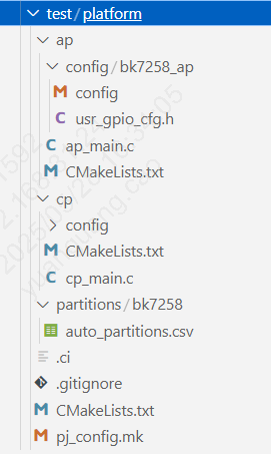

# 工程目录结构简介

## 新建工程目录结构

新建工程的目录结构如下：以bk7259的test/platform工程为例;

> 
>
>
> 图1 project_struct
>
> - bk_package.json是用于最后的固件打包，其中的数值在编译时根据分区表自动生成,路径在： `build/bk7259/platform/partitions/bk_package.json`；
> - 新建工程的ap_main.c中的main函数中需包含bk_init();已确保响应基本的命令；
