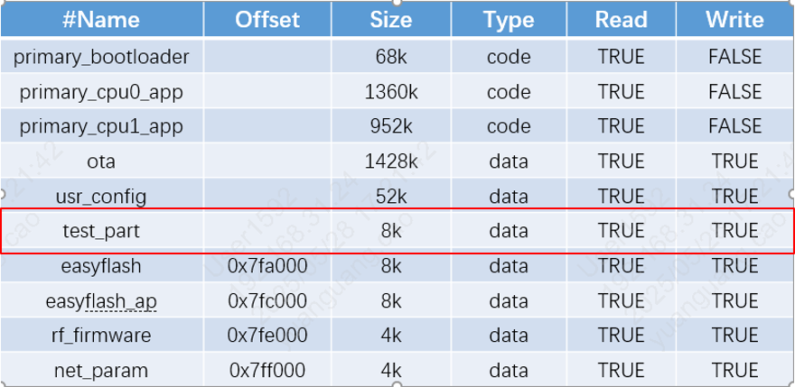
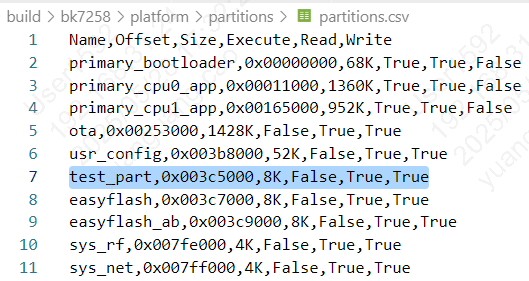

# 修改分区简介

## 修改分区

> - 1） 建议从usr_config和easyflash分区之间插入新增分区；
> - 2） name不可和已有的分区重名;
> - 3） 需要的Size建议通过缩减user_config分区Size获得，所有分区的Size总和不得超过所用flash的实际Size；
> - 4） 在sdk默认分区csv表中新增test_part分区示例如下。
>
> 
>
>
> 图7 add_partition
>
> - 5） 看新增分区是否生效，可以在``partitions_gen.h``中查看是否有该分区。
>
> 
>
>
> 图9 partitions_csv
>
> -6) 新增分区之后，若想在代码区调用该分区，如test_part这个分区 ，
> 则使用BK_PARTITION_TEST_PART 这个宏定义即可，定义在 `partitions_gen.h` 中，通过引用 `<driver/flash_partition.h>`
> 即可访问该宏。
>
> -7) 分区修改之后，需要先执行make clean;
