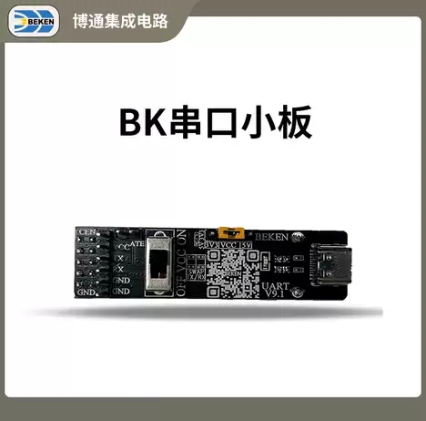
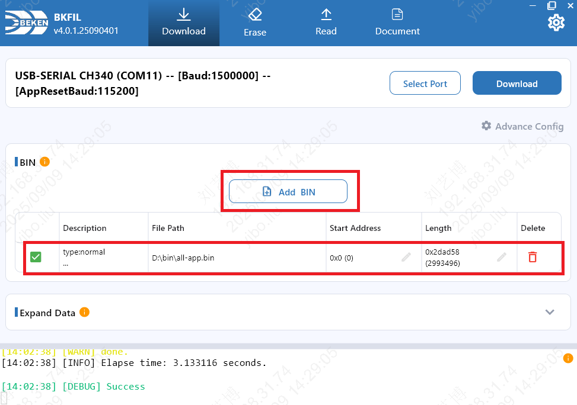

# 快速入门


本文档以 BK7259 开发板为例，通过一个简单的示例项目向您展示:

> - 代码下载；
> - 环境部署及编译；
> - 工程配置；
> - 固件编译与烧录；


## 准备工作

硬件：

> - BK7259 开发板(请找对应接口人申请)；
> - 串口烧录工具；
> - PC；


## Armino SDK 代码下载

您可从 gitlab、github 或 gitee 上下载 Armino SMP 代码，任选其一即可:


```
mkdir -p ~/armino
cd ~/armino


# gitlab
git clone https://gitlab.bekencorp.com/armino/bk_avdk_smp.git -b release/v4.0.1


# github
git clone https://github.com/bekencorp/bk_avdk_smp.git -b release/v4.0.1


# gitee
git clone https://gitee.com/bekencorp/bk_avdk_smp.git -b release/v4.0.1

```

警告

Windows下通过git clone拉取代码，存在换行符的问题，会导致编译失败，请按照以下方式解决:


- 换行符问题:

  1.下载代码前先配置git环境变量:

  ```
  git config --global core.autocrlf false
  ```

备注

gitlab只针对企业用户开放，请找对应接口人申请。


## 环境部署及编译

我们提供了本地编译环境和Docker编译环境两种部署方式，用户可根据硬件和使用习惯选择一种方式部署，我们更推荐使用本地编译环境。

本地部署方案目前仅支持Windows和Linux系统下的编译。

Docker部署是基于Docker容器的环境部署与编译方案，支持在Linux、macOS及Windows系统上高效完成编译工作。
借助Docker容器化技术，您无需手动安装编译所需的各类库文件及工具链，从而显著简化了部署与编译流程。
该方案适用于熟悉Docker环境并了解其基本使用方法的用户，可帮助您快速实现环境的部署与编译。
对于不熟悉Docker技术或因网络条件限制无法使用Docker环境的用户，请使用本地编译部署方案。


- [本地部署](get-started/env-manual.md "env-manual.md")

- [Docker部署](get-started/env-docker.md "env-docker.md")

- [Menuconfig 使用指南](get-started/menuconfig.md "menuconfig.md")


## 配置工程


- 您可以通过 `menuconfig` 或工程配置文件来更改默认配置，也可以针对不同芯片进行差异化配置。推荐优先使用 `menuconfig`，详细方法参考 [Menuconfig 使用指南](get-started/menuconfig.md#bk7259-get-started-menuconfig "get-started/menuconfig.md#bk7259-get-started-menuconfig")。

- 工程配置文件的优先级如下:

  ```
  工程配置文件 Override 芯片配置文件 Override 默认配置
  如： projects/app/ap/config/bk7259_ap/defconfig >> ap/middleware/soc/bk7259_ap/bk7259_ap.defconfig >> Kconfig

  + 工程配置文件示例：
      projects/app/ap/config/bk7259_ap/defconfig
      projects/app/cp/config/bk7259/defconfig

  + 芯片配置文件示例：
      ap/middleware/soc/bk7259_ap/bk7259_ap.defconfig
      cp/middleware/soc/bk7259/bk7259.defconfig

  + KConfig 配置文件示例：
      ap/middleware/arch/cm33/Kconfig
      ap/components/bk_cli/Kconfig
      cp/middleware/arch/cm33/Kconfig
      cp/components/bk_cli/Kconfig
  ```

- 模块选择CPUx执行

  > - 在当前 BK7259 SMP 代码库中，CPU0 与 CPU1 组成通信处理器(CP) SMP 子系统，CPU2 与 CPU3 组成应用处理器(AP) SMP 子系统，AP 和 CP 分别独立生成镜像。
  > - 比如TRNG随机数控制器只有一份，使用多核配置时，应用程序需要互斥配置在哪一个系统(AP/CP)中执行。
  > - 模块的功能开关CONFIG_TRNG宏默认关闭, 若AP或CP系统需要, 应在相应的系统的配置文件中打开。
  >   假设CP需要使用TRNG，而AP不需要使用，则在cp的默认配置文件bk7259.defconfig中的CONFIG_TRNG=y。
  > - 在软件代码中，使用CONFIG_TRNG宏隔离调用。
  >   示例如下:
  >
  >   ```
  >   #if CONFIG_TRNG             #使用模块功能开关宏隔离代码
  >   #include "driver/trng.h"
  >   #endif
  >   ...
  >   #if CONFIG_TRNG             #使用模块功能开关宏隔离代码
  >   bk_rand();
  >   #endif
  >   ```


## 新建工程


- 新建工程介绍: [create_new_project](get-started/../developer-guide/create_new_project_rule/bk_configure_partition_Table.md "../developer-guide/create_new_project_rule/bk_configure_partition_Table.md")

- 创建工程后，可以进行 `menuconfig` 配置，配置方法参考 [Menuconfig 使用指南](get-started/menuconfig.md#bk7259-get-started-menuconfig "get-started/menuconfig.md#bk7259-get-started-menuconfig")。


## 烧录代码

Armino 支持在 Windows/Linux 平台进行固件烧录, 烧录方法参考烧录工具中指导文档。
以Windows 平台为例， Armino 目前支持 UART 烧录。
app工程在编译完成后，在build/bk7259/app/package目录下生成all-app.bin，使用此bin文件烧录即可。


### 通过串口烧录

备注

Armino 支持 UART 烧录，推荐使用 CH340 串口工具小板进行下载。BEKEN 串口工具小板 [淘宝链接](https://www.taobao.com/list/item/Z0RXSzFtdXdMU2FEYit2RzdVdEdTdz09.htm "https://www.taobao.com/list/item/Z0RXSzFtdXdMU2FEYit2RzdVdEdTdz09.htm") 。

串口烧录工具如下图所示:



UART

烧录工具（BKFIL）获取：

> [https://dl.bekencorp.com/tools/bkfil/v4/gui](https://dl.bekencorp.com/tools/bkfil/v4/gui "https://dl.bekencorp.com/tools/bkfil/v4/gui")
> 在此目录下获取对应系统的最新版本。

BKFIL.exe 界面及相关配置如下图所示：



BKFIL GUI

选择烧录串口 DL_UART0，点击 `烧录` 进行版本烧录, 烧录完成之后掉电重启设备。
如果烧录过程无法获取设备，卡在 `Getting Bus...` 时，可以按一下重启键，恢复cpu状态。

点击 [BKFIL](https://docs.bekencorp.com/arminodoc/bk_app/bkfil_v4/zh_CN/latest/intro/intro.html "https://docs.bekencorp.com/arminodoc/bk_app/bkfil_v4/zh_CN/latest/intro/intro.html") 进一步了解 Armino 烧录工具。


## 开机log和命令行工具

烧录后连接串口DL_UART0(UART0)，设置波特率为115200，开机后即可看到开机log。
在BK7259 SMP系统中，Cli 命令也通过DL_UART0(UART0)串口进行通信；使用串口通信工具输入help 命令查看支持命令列表。

## 模块导航

- [env-docker](get-started/env-docker.md)
- [env-manual](get-started/env-manual.md)
- [manual_install](get-started/manual_install.md)
- [menuconfig](get-started/menuconfig.md)

