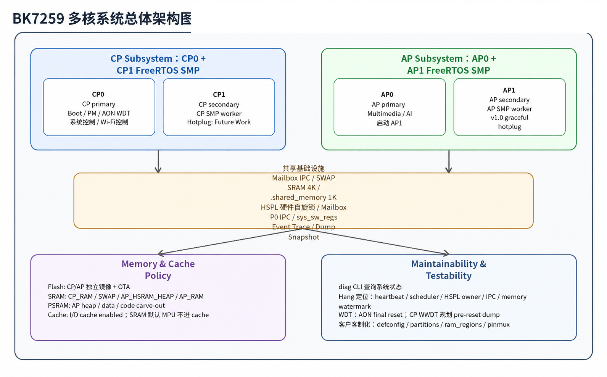

# 博通集成 Armino SMP开发框架

这是博通集成 Armino SMP开发框架的官方文档。

AP(SMP)+CP 系统

本文档基于Armino CP和Armino AP, 帮助用户开发应用;

应用处理器AP配置和使用, 请参考 [Armino AP](ap_doc/index.md "ap_doc/index.md")

通信处理器CP配置和使用, 请参考 [Armino CP](cp_doc/index.md "cp_doc/index.md")

